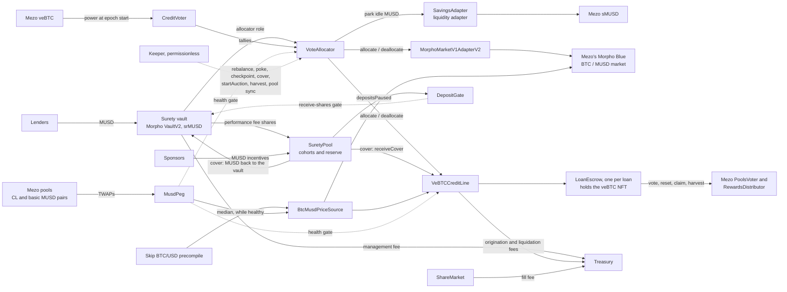

# Surety

Lending gauges for MUSD on Mezo: veBTC holders decide where a MUSD lending vault lends, and their own rewards are the first loss when a line they backed goes bad.

[App](https://surety-credit.vercel.app) · [Demo video](https://youtu.be/dHxYqFmqjEg) · [Deck](https://surety-credit.vercel.app/surety-deck.pdf) · [What changed since Wave 1](FEEDBACK-RESPONSE.md) · [Architecture](docs/ARCHITECTURE.md) · [Security](docs/SECURITY.md) · [Proof](docs/PROOF.md) · [Claims](docs/CLAIMS.md) · [Business](docs/BUSINESS.md)

Borrow MUSD against your veBTC without unlocking it, and let the NFT's own fees and bribes pay the loan down. Or lend MUSD, knowing the veBTC holders who steer your money stand in front of you when a loan goes bad: in the v1 run on testnet, a −60% BTC shock left 157.16 MUSD of bad debt, and the voters' rewards covered 120.18 MUSD of it (76%); lenders bore the rest.

In most money markets a curator picks where deposits go and loses nothing when a listing fails. Mezo described the alternative in [Aerodrome for lending](https://mezo.org/blog/aerodrome-for-lending): let vote-escrow holders steer lending the way gauges steer liquidity, so that votes become a price for risk. Surety builds that for MUSD credit. Lenders deposit MUSD into a Morpho VaultV2. Every epoch, veBTC holders split their voting power across credit lines, and the vault's capital follows the votes. Voters earn the vault's performance fee and sponsor incentives, but those rewards season for four epochs and are slashed first if a line they voted for records a loss; the pool's reserve comes second and lenders last. One of the lines lends MUSD against a locked veBTC NFT without unlocking it: the NFT sits in its own escrow and keeps voting and earning for the borrower, and those earnings can repay the loan.

Status: v2 is live on Mezo mainnet (chain 31612, deployed 2026-11-09) on Mezo's own Morpho Blue, with 2,000 MUSD caps on each line and every contract verified on Sourcify ([addresses](#deployments)). Real MUSD runs through it: on 2026-11-12 the vault held 2.5 MUSD from the team's own wallet, with 1.125 MUSD supplied to Surety's market on Mezo's Morpho Blue (1 MUSD borrowed there), 1.125 MUSD in the veBTC line (1 MUSD lent against veBTC #6178, whose escrow votes on Mezo's PoolsVoter) and 0.25 MUSD in sMUSD ([transactions](docs/PROOF.md#live-on-mainnet-v2)). It is also live on Mezo testnet (chain 31611, lifecycle recorded) on Mezo's testnet Morpho Blue. v1 stays deployed on both networks. The code has had an internal review and two independent reviews (v1 and the v2 changes), not an external audit.

Pending — the first auto-repay harvest of the mainnet loan, from the Mezo epoch flip on 2026-11-19 00:00 UTC; and outside users: every wallet so far is the team's.

## What's new in v2

Each point of the Wave 1 review, with the commits, the transactions and what is still pending, is answered in [FEEDBACK-RESPONSE.md](FEEDBACK-RESPONSE.md). In short:

- **MUSD is priced, not assumed.** `MusdPeg` reads MUSD/USD from four of Mezo's pools. BTC collateral is priced through it with any premium capped at 3%, and new veBTC borrowing and new allocations stop while MUSD is off its peg. On testnet a borrow sent during a simulated depeg [reverted on chain with `PegUnhealthy`](https://explorer.test.mezo.org/tx/0x6438e38d8cd1dfb4f522a6c72c25cf987e97e98201d2838d2f7a7942633f8e16).
- **A wider auction cushion.** The veBTC line auctions from 65% LTV down to an 85% floor (v1: 70% and 70%), so an auction started at the trigger repays debt and fee even at the floor. A −32.59% shock on testnet ended in an auction [with no shortfall](https://explorer.test.mezo.org/tx/0x69ba998d4a6071942e0c77873dd5f554ec04f2415ad806ff0ce720cc9652aae1).
- **veBTC rewards repay the loan.** With auto-repay on, anyone can harvest the escrowed NFT's fees and bribes into repayment; the rebase compounds into the lock. On testnet, after the Mezo epoch flip on 2026-11-12, the keeper's harvest claimed 0.16764 MUSD of fees and bribe and [repaid the loan with it](https://explorer.test.mezo.org/tx/0x04bef77906dbad8690ea3a6a2a9d2dfa1b8ce5ff782236280976dcc4b36509e6); a v1 escrow [claimed 0.28099 MUSD](https://explorer.test.mezo.org/tx/0x4c69cd096ea6a5123de7357268541bb0bfd7ffaa9ac1565db00cf899cc3d057a) to its borrower and [its rebase](https://explorer.test.mezo.org/tx/0x5fd3f2f9e1d7ef3a6ad70b6151bc94b98dcdf9f0fef89c3a0c639172c29e76d0) into the lock. On mainnet a loan's escrow [votes on Mezo's PoolsVoter](https://explorer.mezo.org/tx/0x2706f059e6e99d9c2fc19c1b7ebf6972ba067f581e9f9fff486d9e333bfc1574) with auto-repay on. Pending — its first harvest, from the Mezo flip on 2026-11-19 00:00 UTC.
- **Fees that fund the protocol.** 0.25% origination, 20% of the liquidation fee (half of it to whoever starts the auction), 0.20% a year management fee and 0.10% on share-market fills, all to a treasury. [docs/BUSINESS.md](docs/BUSINESS.md) says who pays whom, what it adds up to, and who pays the team.
- **Idle cash in sMUSD.** The vault's idle MUSD, its 10% buffer included, sits in Mezo's sMUSD through a VaultV2 liquidity adapter.
- **A market for vault shares.** Lenders can sell srMUSD at a discount when the vault's cash is lent out.
- **Try it on testnet.** A starter kit (gas, a veBTC lock, test MUSD) for any new wallet, a key kept in the browser, Mezo Passport's Bitcoin wallets, and a ledger of every wallet that has used Surety, team wallets labelled. Pending — outside users; none yet.
- **Mezo's own Morpho Blue on both networks.** On mainnet v2 lends through a new BTC/MUSD market (LLTV 86%) on Mezo's Morpho Blue; on testnet it uses Mezo's testnet Morpho Blue instead of a self-deployed one.
- **A faster app.** First paint from a build snapshot, every RPC call time-boxed with fallbacks, checked in headless Chrome with the RPCs blocked.
- **Reviewed again.** An independent review of the v2 changes found 1 high, 2 medium and 2 low issues; all are fixed, each with regression tests.

## Review in 5 minutes

1. **Use the app.** Open [surety-credit.vercel.app](https://surety-credit.vercel.app) and choose **Open the credit board** (`/app`). `/app/review` lists ten checks, each with where to see it. `/app/try` takes a new visitor from a testnet starter kit to a veBTC loan with no wallet installed. `/app/peg` shows the MUSD peg's sources and, on testnet, lets anyone push MUSD off its peg for a few minutes. The **Stress test** panel on the board (testnet only) applies a temporary BTC haircut of up to 90% for up to 2 hours. `/app?demo=1` shows every page on example data without a wallet, and `/app/proof` lists the contracts and the recorded transactions of both versions.

2. **Check the contracts.** All 19 Surety contracts in [`contracts/deployments/31612.json`](contracts/deployments/31612.json) (v2 mainnet), the 18 in [`contracts/deployments/31611.json`](contracts/deployments/31611.json) (v2 testnet), the 14 in [`contracts/deployments/v1/31611.json`](contracts/deployments/v1/31611.json) and the 11 in [`contracts/deployments/v1/31612.json`](contracts/deployments/v1/31612.json) are an exact match on Sourcify. Links for each are in [docs/PROOF.md](docs/PROOF.md#verified-contracts) and under [Deployments](#deployments).
3. **Follow real MUSD on mainnet.** The team's own wallet put real MUSD through the v2 mainnet deployment on 2026-11-10 and 2026-11-12: a deposit, a vote, the rebalance into Surety's market on Mezo's Morpho Blue and the veBTC line, a veBTC loan whose escrow votes on Mezo, and a Morpho borrow. The key steps; every transaction and the state it left are in [docs/PROOF.md](docs/PROOF.md#live-on-mainnet-v2):

   <!-- proof:key-steps-31612:start -->
   - Real MUSD deposited into the mainnet vault, parked in Mezo's sMUSD: [0x7d97…213d](https://explorer.mezo.org/tx/0x7d975656b297ad55730cf9f77ca3cf5a8e7d16711051d162bc78c5ee0eea213d)
   - sMUSD yield harvested and re-deposited: [0x9219…488c](https://explorer.mezo.org/tx/0x9219e7e7a4affd1c13e1c7d2be6f5ba0e366face879e7e85d4e0b49b4190488c)
   - Rebalance by the votes: MUSD supplied to Surety's market on Mezo's Morpho Blue and lent to the veBTC line: [0x4bc7…65d4](https://explorer.mezo.org/tx/0x4bc72f1a50a1e6999e83a3a18616438f177fdafd10bf4870587be4df77bd65d4)
   - veBTC loan against a mainnet lock, origination fee to the treasury: [0x26ba…f719](https://explorer.mezo.org/tx/0x26ba1c58ca6735a33d9b65f77f01758ef88bd9833e67373d30ca9422419ef719)
   - The loan's escrow votes the NFT on Mezo's PoolsVoter: [0x2706…1574](https://explorer.mezo.org/tx/0x2706f059e6e99d9c2fc19c1b7ebf6972ba067f581e9f9fff486d9e333bfc1574)
   - MUSD borrowed from Surety's market on Mezo's Morpho Blue: [0xfeb5…b999](https://explorer.mezo.org/tx/0xfeb519ffd962f04f8d3a710595917f2f2d57d01cf0b1c6dc0f7f2b60827cb999)
   - Auto-repay: the escrow's fees and bribes harvested into repayment after the Mezo flip: PENDING (not recorded yet)

   <!-- proof:key-steps-31612:end -->

4. **Follow v2 on chain.** `keeper/scripts/testnet-cycle-v2.ts` ran v2 end to end on testnet, each role from its own account. The key steps; every transaction is in [docs/PROOF.md](docs/PROOF.md#live-lifecycle-on-testnet-v2):

   <!-- proof:key-steps-v2:start -->
   - Lender deposit parks in sMUSD through the liquidity adapter: [0xe25a…51f8](https://explorer.test.mezo.org/tx/0xe25a1e53b909718a19de0b74823a81c6ad68a66b596f950c1f4006f49c8d51f8)
   - Rebalance moves the capital from sMUSD to the lines by the votes: [0x5fe4…c5b2](https://explorer.test.mezo.org/tx/0x5fe4a449d6793cba4e511c7a1cd579e9220851c61be8f15a08d685afddbfc5b2)
   - veBTC loan opened, origination fee to the treasury (`OriginationFeePaid`): [0x9f8d…99f9](https://explorer.test.mezo.org/tx/0x9f8decd8a5fa3e6944f3186d0d7f59f915627ee569558e4425da8858e2ea99f9)
   - The loan's escrow votes the NFT on Mezo's PoolsVoter: [0x1a50…0430](https://explorer.test.mezo.org/tx/0x1a50ee48bfa2a189fab44bbdccf936f6f630c4fe994766e0ce4d575529720430)
   - Depeg breaker: a borrow sent while MUSD reads $0.94 reverts on chain with `PegUnhealthy`: [0x6438…8e16](https://explorer.test.mezo.org/tx/0x6438e38d8cd1dfb4f522a6c72c25cf987e97e98201d2838d2f7a7942633f8e16)
   - Auction bid above debt + fee: no shortfall, fee split to lenders, treasury and keeper (`LiquidationFeePaid`): [0x69ba…aae1](https://explorer.test.mezo.org/tx/0x69ba998d4a6071942e0c77873dd5f554ec04f2415ad806ff0ce720cc9652aae1)
   - ShareMarket fill: a lender sells srMUSD at a discount, 10 bps to the treasury: [0x741e…de8a](https://explorer.test.mezo.org/tx/0x741e1b596a09c35b382c5ef245c16a168ea6eb725f86e09b2ceb2088ecbfde8a)
   - Starter kit through the Sponsor's relayer (team test wallet): [0x823f…1477](https://explorer.test.mezo.org/tx/0x823f99fc7d1e6efb55facc06676708f48fc994ee111de45259847107e5321477)
   - Auto-repay: the escrow's bribes and fees harvested into repayment after the Mezo flip: [0x04be…09e6](https://explorer.test.mezo.org/tx/0x04bef77906dbad8690ea3a6a2a9d2dfa1b8ce5ff782236280976dcc4b36509e6)

   <!-- proof:key-steps-v2:end -->

5. **Follow a loss on chain (v1).** The v1 lifecycle ran a deposit, two votes, a rebalance, incentives, a veBTC loan and a Morpho borrow, then a −60% price shock. These are the transactions where the loss happens and is paid for. In each cover, the `CohortSlashed` events show the shares taken from voters and `Covered` shows the MUSD moved. Every transaction is in [docs/PROOF.md](docs/PROOF.md#live-lifecycle-on-testnet).

   <!-- proof:key-steps:start -->
   - Morpho liquidation leaves bad debt: [0x9fd3…0723](https://explorer.test.mezo.org/tx/0x9fd30e57406f16ef8c279011ec20f47b6783164579ad0f3668c06c5e1bec0723)
   - veBTC auction settles below the debt (shortfall): [0x32c4…79ad](https://explorer.test.mezo.org/tx/0x32c467bc1ee7b9b5ae1eef870c4f3f8e6149bfda4a381739dda646ffd23479ad)
   - Loss recorded on the Morpho line: [0x34c0…00a8](https://explorer.test.mezo.org/tx/0x34c07182444af905b13e4d22705d16d878bd0ab8c37ee1361b4851bef45f00a8)
   - Loss recorded on the veBTC line: [0x9aeb…da00](https://explorer.test.mezo.org/tx/0x9aebba4424e43ed91863469c282e7c251ae855fe1c1f5e54cdd61bec8844da00)
   - Cover: voter cohort slashed, MUSD returned to the vault: [0x7a52…8b03](https://explorer.test.mezo.org/tx/0x7a528516a84e5eebc6d6b32aa99103e7ec8bc2b0b7669457f82d01fd70188b03)
   - Cover: voter cohort slashed, MUSD paid into the veBTC line: [0xf260…ae9b](https://explorer.test.mezo.org/tx/0xf260dae6094b993d93781f3f6e202e93d76344047a39ff46f86fcaa2e9b4ae9b)
   - Next epoch: rebalance attributes interest to the cohorts: [0x8f22…622c](https://explorer.test.mezo.org/tx/0x8f22a2de4732ffc0ff32dfec7576c8fdcf2ec4a7234905cb43d98ed286b6622c)

   <!-- proof:key-steps:end -->

6. **Run the tests.**

   ```sh
   cd contracts && forge test      # 379 passed, 4 skipped (the opt-in mainnet fork suites)
   pnpm install && pnpm test       # 173 passed: sdk 83, keeper 56, mcp 13, web 21
   ```

## How it works

**Lend.** Lenders deposit MUSD into the Surety vault, a Morpho VaultV2, and receive srMUSD. Deposits land in Mezo's sMUSD through the `SavingsAdapter`, the vault's liquidity adapter; each rebalance funds the lines from there and keeps 10% of the vault's assets parked as a buffer for withdrawals and covers. Withdrawals are never paused; an exit larger than the vault's cash can use VaultV2's `forceDeallocate`, which pulls from a line's free liquidity for a 1% penalty paid to the remaining lenders, or sell srMUSD on the `ShareMarket` at a discount the seller picks. The vault charges a 0.20% a year management fee to the treasury.

**Vote.** Each epoch, a veBTC NFT can split its boosted voting power, read at the epoch start, across up to 10 credit lines. Votes cast in epoch t decide the vault's allocation from the first rebalance of epoch t+1. The rebalance is permissionless. It splits the deployable assets by votes, within the vault's caps, and moves capital through VaultV2's own `allocate` and `deallocate`.

**Underwrite.** Rewards for backing a line go into a cohort keyed by line and tally epoch: the vault's 10% performance fee on that line's interest, and any MUSD incentives sponsors post for the line's voters. A cohort is held as srMUSD and seasons until epoch t+6 (a two-epoch lag plus four epochs of seasoning). Until then, if the line records a loss, `cover` takes from that line's unmatured cohorts first, then from the shared reserve, and returns the MUSD to the vault or the line. Whatever the pool cannot cover stays with lenders. Matured cohorts are never slashed and are claimed pro rata to each NFT's votes. The fee on sMUSD yield goes to the reserve.

**Borrow.** Two lines are live:

- *BTC / MUSD on Morpho Blue.* Borrowers post BTC on a market on Mezo's own Morpho Blue (LLTV 86% on mainnet, 77% on testnet) priced by `BtcMusdPriceSource`. Liquidations follow Morpho's own rules.
- *veBTC credit line.* Borrowers take MUSD against a locked veBTC NFT without unlocking it: up to 50% LTV on timed locks, 40% on permanent locks, with a 0.25% origination fee. Each loan's NFT sits in its own escrow, keeps voting on Mezo's gauges and earning fees, bribes and rebase for the borrower, and can be extended or topped up. With auto-repay on, anyone can harvest those rewards into repayment. At 65% LTV, or when a timed lock reaches its end, anyone can start a Dutch auction that falls from the collateral value to an 85% floor. The 3% liquidation fee goes 80% to lenders, 10% to the treasury and 10% to whoever started the auction. A sale below the debt is recorded as bad debt, which the pool covers.

**Price.** BTC is priced in MUSD: Skip's BTC/USD divided by MUSD/USD from `MusdPeg`, the median of sources built on Mezo's own pools, clamped to [$1, $1.03] and used only while the peg is healthy; otherwise MUSD counts as exactly $1. While the peg is unhealthy, new veBTC borrowing and new allocations stop; repayments, auctions and withdrawals go on.

## Architecture



The contracts, the MUSD peg, the fees, the epoch timeline, the loss waterfall and the exact cover sizing are described in [docs/ARCHITECTURE.md](docs/ARCHITECTURE.md).

## Built on Mezo

| Primitive | How Surety uses it |
| --- | --- |
| **MUSD** | The vault asset, the loan asset of both lines, and the currency of incentives, fees and covers. In v2 its USD price comes from `MusdPeg`; v1 valued it at exactly $1. |
| **veBTC voting power** | `CreditVoter` weighs each ballot with `votingPowerOfNFTAt(tokenId, epochStart)`, the boosted power at the epoch start, so transfers, merges and new locks within the epoch add nothing. Weekly epochs flip on Thursday 00:00 UTC, like Mezo's. |
| **veBTC locks as collateral** | The veBTC line values `locked.amount` at the BTC price in MUSD and accepts only normal NFTs (no managed or grant locks). The NFT moves by plain `transferFrom` into a fresh escrow. |
| **PoolsVoter and RewardsDistributor** | Through its escrow, the borrower keeps voting Mezo's gauges (`vote`, `reset`), claims fees and bribes (`claimFeesAndBribes`) and the veBTC rebase (`RewardsDistributor.claim`); claims are forwarded to the borrower, or with auto-repay `harvest` turns the MUSD into repayment. Escrow votes, bribes, both claims and an auto-repay harvest are on chain on testnet; on mainnet a loan's escrow votes on Mezo's CL mUSDC/MUSD pool. |
| **Skip BTC/USD precompile** (`0x7b7c…0015`) | `SkipPriceSource` reads it with a 60-second maximum age, the bound MUSD's own price feed uses, and reverts on stale, non-positive or future-dated rounds. `BtcMusdPriceSource` divides it by the peg; `BtcCrossPegSource` uses it to read MUSD/USD from the CL BTC/MUSD pool. |
| **Tigris pools** | `MusdPeg`'s mainnet sources read Mezo's CL mUSDC/MUSD (`0xCC37…aC1a`) and CL BTC/MUSD (`0x9CBc…5022`) TWAPs through `observe`, with a floor on the window's in-range liquidity, and the basic mUSDC/MUSD (`0xEd81…c356`) and MUSD/mUSDT (`0x1090…031A`) pools through `quote`, with a freshness bound the keeper keeps by calling `sync`. |
| **sMUSD** (MUSD Savings Rate) | `SavingsAdapter` parks the vault's idle MUSD in it as VaultV2's liquidity adapter (mainnet `0xb4D4…51CC`, testnet `0x6f46…8e16`); its yield's fee part goes to the pool's reserve. |
| **Morpho Blue and AdaptiveCurveIrm** | Mezo's own on both chains: mainnet Morpho Blue ([`0x5658…A311`](https://explorer.mezo.org/address/0x565834cE7E40b8987BC20EbF83E2159467bDA311)) and IRM ([`0x3760…C1e7`](https://explorer.mezo.org/address/0x3760Ebc636F912a4dB9540fdA4Dec09C25C6C1e7)) at LLTV 86%; testnet Morpho Blue ([`0xCe1d…5a73`](https://explorer.test.mezo.org/address/0xCe1da828cA15cb1FDAfa84C366A53C8106655a73)) and IRM ([`0x0c97…7441`](https://explorer.test.mezo.org/address/0x0c97Fe017628636649ff374aD499529F91167441)) at LLTV 77%, the LLTV each enables. v1 on testnet used a Morpho Blue deployed from the pinned sources. |
| **Morpho VaultV2 and MorphoMarketV1AdapterV2** | Vendored unmodified from `morpho-org/vault-v2` at commit `97bcce9`. The 13 source files of Mezo's verified VaultV2 ([`0x0629…6a8B`](https://explorer.mezo.org/address/0x06291b67e3d7660240ab44Afc9a708d82b976a8B)) and the 25 of its MorphoMarketV1AdapterV2 ([`0xb0EE…4F61`](https://explorer.mezo.org/address/0xb0EE3a01d9134733155B28289c09f084Acca4F61)) are identical to this tree. Surety's logic enters only through VaultV2's roles and hooks: allocator, performance- and management-fee recipients, receive-shares gate, liquidity adapter and adapters. |
| **Mezo Passport** | The app's wallet dialog offers Passport's Bitcoin wallets (Unisat, OKX, Xverse) next to EVM wallets and WalletConnect. `@mezo-org/passport` is GPL-3.0 and is loaded as a separate client chunk, only when a Bitcoin wallet is installed or asked for. |
| **ERC4626VaultAdapter and vault gauges** (planned) | srMUSD is an ERC-4626 share, so Mezo's ERC4626VaultAdapter can wrap it and a governance call to `PoolsVoter.createVaultGauge` can pay MEZO emissions to lenders, the same wiring as Mezo's existing lending vault gauge. Not deployed: it needs Mezo governance. |

## Repository layout

```
contracts/          Foundry project
  src/              CreditVoter, VoteAllocator, SuretyPool, DepositGate, SavingsAdapter, ShareMarket
    lines/          VeBTCCreditLine, LoanEscrow, LinearKinkIrm
    oracles/        SkipPriceSource, BtcMusdPriceSource, MorphoPriceOracle, StressedPriceSource (testnet only)
      peg/          MusdPeg and its sources: ClTwap, StableTwap, BtcCross, Stressed (testnet only)
    testnet/        Sponsor: starter kits (testnet only)
    libraries/      EpochLib, LineIds, TickPrice
    interfaces/     Surety and Mezo interfaces
  script/           Deploy.s.sol: the whole system on Mezo's Morpho Blue
  test/             unit, integration, invariant, audit (review regressions), script, fork (opt-in)
  deployments/      <chainId>.json (v2), v1/ (the first deployments), dry-run/
  lib/              forge-std, OpenZeppelin, morpho-blue, morpho-blue-irm, vault-v2 (submodules)
packages/sdk/       @surety/sdk: typed reads and unsigned transaction builders (viem)
packages/mcp/       @surety/mcp: MCP server over the SDK; returns unsigned calldata, holds no keys
keeper/             @surety/keeper: permissionless keeper, plus the testnet lifecycle and escrow scripts
apps/web/           Next.js app: landing, credit board, vote, lend, borrow, peg, market, sponsor, auctions,
                    business, try it, users ledger, review, proof; plus the starter-kit relayer function
docs/               architecture, security, proof, claims and business
```

## Quick start

Requirements: Foundry 1.x, Node 22.18 or later, pnpm 9.15.

### Contracts

```sh
git submodule update --init
git -C contracts/lib/vault-v2 submodule update --init lib/morpho-blue lib/morpho-blue-irm
git -C contracts/lib/vault-v2/lib/morpho-blue-irm submodule update --init lib/morpho-blue
git -C contracts/lib/morpho-blue-irm submodule update --init lib/morpho-blue

cd contracts
forge build
forge test                                             # 379 passed, 4 skipped
SURETY_FORK=true forge test --match-contract 'LiveMezo|LivePeg|LiveSavings|AuditV2Fork'   # 18, against live Mezo mainnet state
```

Initialise only the nested submodules above: a recursive checkout pulls test dependencies the build does not need, and their paths are too long for a default Windows setup.

### TypeScript packages

```sh
pnpm install
pnpm build    # sdk (bundles contracts/deployments), keeper, mcp, web
pnpm test     # vitest in sdk, keeper and mcp; node --test in web
```

### Keeper

```sh
pnpm keeper --chain 31611 --dry-run --once      # simulate one pass, send nothing
KEEPER_PRIVATE_KEY=0x... pnpm keeper --chain 31611
```

It pokes ballots after each flip, rebalances once per epoch, checkpoints and covers losses, starts auctions, harvests auto-repay loans after each Mezo epoch flip and the savings adapter after each rebalance, and on mainnet syncs the peg's basic pools. It holds no role; every call it makes is open to anyone. Flags and logs: [keeper/README.md](keeper/README.md).

### MCP server

```sh
pnpm mcp                        # stdio, testnet
pnpm mcp --http --port 3333     # streamable HTTP at http://127.0.0.1:3333/mcp
```

Tools: the credit board, the epoch, veBTC borrow quotes, loan health, an NFT's cohorts, the MUSD peg, the fee schedule, the share market, and unsigned transactions for the user and keeper actions. Details: [packages/mcp/README.md](packages/mcp/README.md).

### Web app

```sh
pnpm --filter web dev           # http://localhost:3000
pnpm --filter web check:load    # headless Chrome load check of the production build
```

Build, deploy and the starter-kit relayer: [apps/web/README.md](apps/web/README.md).

### Deploy

```sh
cd contracts
STRESS=true RELAYER_ADDRESS=0x… forge script script/Deploy.s.sol --rpc-url mezo_testnet --broadcast --verify   # testnet stress deployment
forge script script/Deploy.s.sol --rpc-url mezo_mainnet --broadcast --verify                                 # mainnet
```

One run deploys and wires everything on Mezo's own Morpho Blue: the MUSD peg and the BTC/MUSD price over it, a new BTC/MUSD Morpho market, the vault with its Morpho, veBTC-line and sMUSD savings adapters (savings is the liquidity adapter), the voter, allocator, pool, deposit gate, ShareMarket and, on testnet, the starter-kit Sponsor. It sets the fees (10% performance fee to the SuretyPool, 0.20%/yr management fee to the treasury), ends the line-listing bootstrap, raises the timelocks and writes `deployments/<chainId>.json` (schema version 2). Without `--broadcast` it is a dry run that writes `deployments/dry-run/<chainId>.json`. The v1 deployments are kept in `deployments/v1/`. Every variable is optional unless marked:

| Variable | Testnet default | Mainnet default | Meaning |
| --- | --- | --- | --- |
| `DEPLOYER_KEY` | | | Key to broadcast with; otherwise `--sender` / `--account` |
| `STRESS` | `false` | refused | Price BTC through `StressedPriceSource`, which anyone can shock |
| `EPOCH_LENGTH` | 3600 | 604800 | Epoch length in seconds |
| `MUSD`, `BTC`, `VEBTC`, `POOLS_VOTER`, `REWARDS_DISTRIBUTOR`, `SKIP_AGGREGATOR`, `SMUSD` | Mezo testnet | Mezo mainnet | Mezo contract addresses |
| `MORPHO`, `MORPHO_IRM` | Mezo's testnet Morpho `0xCe1d…5a73` and its IRM | Mezo's `0x5658…A311` and AdaptiveCurveIrm | Morpho Blue and the IRM it enables |
| `MORPHO_LLTV` | 0.77e18 | 0.86e18 | LLTV of the new market (the one Mezo enables on each chain) |
| `MORPHO_CAP`, `LINE_CAP` | 10,000,000 MUSD | 2,000 MUSD | Absolute caps on the Morpho ids and the veBTC line ids, in MUSD wei; relative caps are 100% |
| `SAVINGS_CAP` | 1e27 | 1e27 | Absolute cap on the savings adapter (at least 1e27); its relative cap is exactly 100% |
| `AUCTION_DURATION` | 600 | 21600 | Seconds for the auction price to decay to its floor |
| `MIN_TERM` | 3600 | 259200 | Lock time a timed lock must have left to borrow |
| `VAULT_TIMELOCK` | 0 | 86400 | Timelock on every curator function of the vault and the Morpho adapter, and the CreditVoter's line timelock (0 is refused on mainnet) |
| `TREASURY` | deployer | deployer | Fee recipient (origination, liquidation, management and ShareMarket fees); the deployer until a multisig takes over |
| `PEG_MIN_SOURCES`, `PEG_MAX_SPREAD_BPS`, `PEG_BAND_BPS` | 1 / 1000 / 300 | 2 / 1000 / 300 | MusdPeg thresholds |
| `PEG_MAX_PREMIUM_BPS` | 300 | 300 | Largest MUSD premium over $1 the BTC price divides by |
| `PEG_WINDOW`, `PEG_GRANULARITY`, `PEG_MAX_AGE` | | 1800 / 2 / 21600 | TWAP window of the CL sources; quote periods and oldest accepted observation of the basic-pool sources |
| `PEG_CL_MIN_LIQUIDITY`, `PEG_BTC_MIN_LIQUIDITY` | | 1e19 / 2e20 | Harmonic-mean in-range liquidity the CL mUSDC/MUSD and CL BTC/MUSD sources need over the window |
| `PEG_CL_POOL`, `PEG_USDC_POOL`, `PEG_USDT_POOL`, `PEG_BTC_POOL` | | Mezo's pools | CL mUSDC/MUSD, basic mUSDC/MUSD, basic MUSD/mUSDT, CL BTC/MUSD |
| `RELAYER_ADDRESS` | required | | Relayer allowed to hand out starter kits |
| `SPONSOR_BTC`, `SPONSOR_MUSD` | 0.006 BTC / 300 MUSD | | What the deployer funds the Sponsor with |
| `SIMULATE_PRECOMPILES`, `SKIP_PRICE` | `false` | `false` | Dry runs on a local fork only: replace the Skip precompile with a settable mock |
| `DEPLOYMENT_OUT` | | | Output path override |

## Deployments

Contracts are verified on Sourcify with an exact match. Mezo's Blockscout verifier currently lists no Solidity compiler versions (`GET https://api.explorer.test.mezo.org/api/v2/smart-contracts/verification/config` returns an empty `solidity_compiler_versions`, and so does the mainnet explorer's), so contracts cannot be verified there for now.

**Mezo mainnet (31612), v2**: [`contracts/deployments/31612.json`](contracts/deployments/31612.json), deployed on 2026-11-09 in blocks 13,118,781 to 13,118,934 (124 transactions, all successful), on Mezo's own Morpho Blue. It runs the plain Skip price source (no stress knob) and the four-pool MUSD peg, weekly epochs on Mezo's Thursday flip, caps of 2,000 MUSD on the Morpho line and on the veBTC line, and 1-day timelocks on every vault curator function, on the Morpho adapter and on listing new lines. Idle MUSD parks in Mezo's sMUSD. Every Surety contract is an exact match on Sourcify, creation and runtime bytecode; the LoanEscrow implementation, created by the line's constructor, on runtime bytecode. Explorer: [explorer.mezo.org](https://explorer.mezo.org).

<!-- proof:contracts-31612:start -->
| Contract | Address | Verified |
| --- | --- | --- |
| Surety vault (VaultV2, srMUSD) | [`0xFB1226A2C58168044d457b226528236a1F847bE1`](https://explorer.mezo.org/address/0xFB1226A2C58168044d457b226528236a1F847bE1) | [Sourcify](https://repo.sourcify.dev/31612/0xFB1226A2C58168044d457b226528236a1F847bE1) |
| MorphoMarketV1AdapterV2 | [`0x6ab4E79d33a6B13d71fFcc6E9b5a5DD5dDd38295`](https://explorer.mezo.org/address/0x6ab4E79d33a6B13d71fFcc6E9b5a5DD5dDd38295) | [Sourcify](https://repo.sourcify.dev/31612/0x6ab4E79d33a6B13d71fFcc6E9b5a5DD5dDd38295) |
| SavingsAdapter | [`0x9FA1f41E6153eD4FD7BAeA409069d5fcf372A514`](https://explorer.mezo.org/address/0x9FA1f41E6153eD4FD7BAeA409069d5fcf372A514) | [Sourcify](https://repo.sourcify.dev/31612/0x9FA1f41E6153eD4FD7BAeA409069d5fcf372A514) |
| CreditVoter | [`0x1EABc0B7f938F6E119Cb25d7d4F70Bf26db10061`](https://explorer.mezo.org/address/0x1EABc0B7f938F6E119Cb25d7d4F70Bf26db10061) | [Sourcify](https://repo.sourcify.dev/31612/0x1EABc0B7f938F6E119Cb25d7d4F70Bf26db10061) |
| VoteAllocator | [`0x33079321E90987cbD8B13Bc22802361292d8373C`](https://explorer.mezo.org/address/0x33079321E90987cbD8B13Bc22802361292d8373C) | [Sourcify](https://repo.sourcify.dev/31612/0x33079321E90987cbD8B13Bc22802361292d8373C) |
| SuretyPool | [`0xFe5d5E400A086fCc606ED99073d72b6b0557bcAc`](https://explorer.mezo.org/address/0xFe5d5E400A086fCc606ED99073d72b6b0557bcAc) | [Sourcify](https://repo.sourcify.dev/31612/0xFe5d5E400A086fCc606ED99073d72b6b0557bcAc) |
| DepositGate | [`0x99b72dE077dc365537a762dde516c45470512228`](https://explorer.mezo.org/address/0x99b72dE077dc365537a762dde516c45470512228) | [Sourcify](https://repo.sourcify.dev/31612/0x99b72dE077dc365537a762dde516c45470512228) |
| VeBTCCreditLine | [`0x690C2F3Db0FAC14281c2a000CA3214C36516d87D`](https://explorer.mezo.org/address/0x690C2F3Db0FAC14281c2a000CA3214C36516d87D) | [Sourcify](https://repo.sourcify.dev/31612/0x690C2F3Db0FAC14281c2a000CA3214C36516d87D) |
| LoanEscrow implementation | [`0x92Cb86376Fc1ba5b1Da2dE1FE1a1ffD926D27D22`](https://explorer.mezo.org/address/0x92Cb86376Fc1ba5b1Da2dE1FE1a1ffD926D27D22) | [Sourcify](https://repo.sourcify.dev/31612/0x92Cb86376Fc1ba5b1Da2dE1FE1a1ffD926D27D22) |
| LinearKinkIrm (veBTC line) | [`0xc7724370fd27Ae961B3747e601ce9DAac26e7269`](https://explorer.mezo.org/address/0xc7724370fd27Ae961B3747e601ce9DAac26e7269) | [Sourcify](https://repo.sourcify.dev/31612/0xc7724370fd27Ae961B3747e601ce9DAac26e7269) |
| ShareMarket | [`0x5722197a666Ccf158945939fCbE2Aebc892e017a`](https://explorer.mezo.org/address/0x5722197a666Ccf158945939fCbE2Aebc892e017a) | [Sourcify](https://repo.sourcify.dev/31612/0x5722197a666Ccf158945939fCbE2Aebc892e017a) |
| MusdPeg | [`0x07777966126dBf0f3919E217D0A2247156879a5F`](https://explorer.mezo.org/address/0x07777966126dBf0f3919E217D0A2247156879a5F) | [Sourcify](https://repo.sourcify.dev/31612/0x07777966126dBf0f3919E217D0A2247156879a5F) |
| ClTwapPegSource (CL mUSDC/MUSD) | [`0xd29D9199BF441A6da411b6dB4929020240e6bDc0`](https://explorer.mezo.org/address/0xd29D9199BF441A6da411b6dB4929020240e6bDc0) | [Sourcify](https://repo.sourcify.dev/31612/0xd29D9199BF441A6da411b6dB4929020240e6bDc0) |
| StableTwapPegSource (basic mUSDC/MUSD) | [`0xebdBbA24cc595210456e543F7789140d2C93Bc25`](https://explorer.mezo.org/address/0xebdBbA24cc595210456e543F7789140d2C93Bc25) | [Sourcify](https://repo.sourcify.dev/31612/0xebdBbA24cc595210456e543F7789140d2C93Bc25) |
| StableTwapPegSource (basic MUSD/mUSDT) | [`0x9F34Ea63dbC890458B5FF966C013b868bd87f4b0`](https://explorer.mezo.org/address/0x9F34Ea63dbC890458B5FF966C013b868bd87f4b0) | [Sourcify](https://repo.sourcify.dev/31612/0x9F34Ea63dbC890458B5FF966C013b868bd87f4b0) |
| BtcCrossPegSource (CL BTC/MUSD) | [`0xC52AFe4cc75D8da3363fb766551a1C5775b0c9D8`](https://explorer.mezo.org/address/0xC52AFe4cc75D8da3363fb766551a1C5775b0c9D8) | [Sourcify](https://repo.sourcify.dev/31612/0xC52AFe4cc75D8da3363fb766551a1C5775b0c9D8) |
| BtcMusdPriceSource (lines' price) | [`0x6C97a90B2D49D6a6D67177F2D250942A2B4e1279`](https://explorer.mezo.org/address/0x6C97a90B2D49D6a6D67177F2D250942A2B4e1279) | [Sourcify](https://repo.sourcify.dev/31612/0x6C97a90B2D49D6a6D67177F2D250942A2B4e1279) |
| SkipPriceSource (BTC/USD) | [`0x9a5e9c5BfDa2154785056E75f2732306fA205F5d`](https://explorer.mezo.org/address/0x9a5e9c5BfDa2154785056E75f2732306fA205F5d) | [Sourcify](https://repo.sourcify.dev/31612/0x9a5e9c5BfDa2154785056E75f2732306fA205F5d) |
| MorphoPriceOracle | [`0xE3C71349FB0C6b222D82B36161fa2F12294fbb51`](https://explorer.mezo.org/address/0xE3C71349FB0C6b222D82B36161fa2F12294fbb51) | [Sourcify](https://repo.sourcify.dev/31612/0xE3C71349FB0C6b222D82B36161fa2F12294fbb51) |
| Morpho Blue (Mezo's) | [`0x565834cE7E40b8987BC20EbF83E2159467bDA311`](https://explorer.mezo.org/address/0x565834cE7E40b8987BC20EbF83E2159467bDA311) | on Mezo's explorer |
| AdaptiveCurveIrm (Mezo's) | [`0x3760Ebc636F912a4dB9540fdA4Dec09C25C6C1e7`](https://explorer.mezo.org/address/0x3760Ebc636F912a4dB9540fdA4Dec09C25C6C1e7) | on Mezo's explorer |

<!-- proof:contracts-31612:end -->

Lines: 0 is BTC / MUSD on Mezo's Morpho Blue (market `0x4bff245d…3030b8`, LLTV 86%), 1 is the veBTC credit line. The treasury is `0x37D5…C282`, the deployer, until a multisig takes over. Mezo contracts used: MUSD `0xdD46…F186`, BTC `0x7b7C…0000`, veBTC `0x3D4b…f279`, PoolsVoter `0x4823…1f03`, RewardsDistributor `0xb584…74A2`, Skip BTC/USD `0x7b7c…0015`, sMUSD `0xb4D4…51CC`, and for the peg the pools CL mUSDC/MUSD `0xCC37…aC1a`, basic mUSDC/MUSD `0xEd81…c356`, basic MUSD/mUSDT `0x1090…031A` and CL BTC/MUSD `0x9CBc…5022`; full addresses in the deployment file. The configuration read on chain and the peg's first reading are in [docs/PROOF.md](docs/PROOF.md#mezo-mainnet-31612-v2). Since 2026-11-12 it holds real MUSD from the team's own wallet, lent on both lines; see [docs/PROOF.md](docs/PROOF.md#live-on-mainnet-v2).

**Mezo testnet (31611), v2**: [`contracts/deployments/31611.json`](contracts/deployments/31611.json), deployed on 2026-11-09 at block 16,667,109 with `STRESS=true`, 1-hour epochs and no timelocks, on Mezo's own testnet Morpho Blue. Explorer: [explorer.test.mezo.org](https://explorer.test.mezo.org).

| Contract | Address | Verified |
| --- | --- | --- |
| Surety vault (VaultV2, srMUSD) | [`0x52aD2746994a1BC318cDf09b81f7831fB9Af03b8`](https://explorer.test.mezo.org/address/0x52aD2746994a1BC318cDf09b81f7831fB9Af03b8) | [Sourcify](https://repo.sourcify.dev/31611/0x52aD2746994a1BC318cDf09b81f7831fB9Af03b8) |
| MorphoMarketV1AdapterV2 | [`0x6F31B144b51083FBbb8EA160F6f6772e37f4b79b`](https://explorer.test.mezo.org/address/0x6F31B144b51083FBbb8EA160F6f6772e37f4b79b) | [Sourcify](https://repo.sourcify.dev/31611/0x6F31B144b51083FBbb8EA160F6f6772e37f4b79b) |
| SavingsAdapter | [`0x28eDb116683608Db6722dd440627A16FC7Bd30E4`](https://explorer.test.mezo.org/address/0x28eDb116683608Db6722dd440627A16FC7Bd30E4) | [Sourcify](https://repo.sourcify.dev/31611/0x28eDb116683608Db6722dd440627A16FC7Bd30E4) |
| CreditVoter | [`0x16D36BECF7D25af55C1658f428e33Ff34388f255`](https://explorer.test.mezo.org/address/0x16D36BECF7D25af55C1658f428e33Ff34388f255) | [Sourcify](https://repo.sourcify.dev/31611/0x16D36BECF7D25af55C1658f428e33Ff34388f255) |
| VoteAllocator | [`0x69Ef3397c2ffb4B23A8Fd7154243aA9C215673c0`](https://explorer.test.mezo.org/address/0x69Ef3397c2ffb4B23A8Fd7154243aA9C215673c0) | [Sourcify](https://repo.sourcify.dev/31611/0x69Ef3397c2ffb4B23A8Fd7154243aA9C215673c0) |
| SuretyPool | [`0xc9Ca8a280d6c339c3169DEEEFB2e08FcB42AcDE0`](https://explorer.test.mezo.org/address/0xc9Ca8a280d6c339c3169DEEEFB2e08FcB42AcDE0) | [Sourcify](https://repo.sourcify.dev/31611/0xc9Ca8a280d6c339c3169DEEEFB2e08FcB42AcDE0) |
| DepositGate | [`0xfAa1c07591b596cB3aa5D6b8054AE3d6a7Fbd8C7`](https://explorer.test.mezo.org/address/0xfAa1c07591b596cB3aa5D6b8054AE3d6a7Fbd8C7) | [Sourcify](https://repo.sourcify.dev/31611/0xfAa1c07591b596cB3aa5D6b8054AE3d6a7Fbd8C7) |
| VeBTCCreditLine | [`0x390B074E003559Cc1868cac0D06A4364BdeDb6f1`](https://explorer.test.mezo.org/address/0x390B074E003559Cc1868cac0D06A4364BdeDb6f1) | [Sourcify](https://repo.sourcify.dev/31611/0x390B074E003559Cc1868cac0D06A4364BdeDb6f1) |
| LoanEscrow implementation | [`0x8d4A899372b543641468731B65f05CF74bA7ec6D`](https://explorer.test.mezo.org/address/0x8d4A899372b543641468731B65f05CF74bA7ec6D) | [Sourcify](https://repo.sourcify.dev/31611/0x8d4A899372b543641468731B65f05CF74bA7ec6D) |
| LinearKinkIrm (veBTC line) | [`0x5067524ECfFEa0A43c7eA49BBe4D73663E28a667`](https://explorer.test.mezo.org/address/0x5067524ECfFEa0A43c7eA49BBe4D73663E28a667) | [Sourcify](https://repo.sourcify.dev/31611/0x5067524ECfFEa0A43c7eA49BBe4D73663E28a667) |
| ShareMarket | [`0x226EA3452D4238fE7Ff5a5600B5bCd991082e51a`](https://explorer.test.mezo.org/address/0x226EA3452D4238fE7Ff5a5600B5bCd991082e51a) | [Sourcify](https://repo.sourcify.dev/31611/0x226EA3452D4238fE7Ff5a5600B5bCd991082e51a) |
| MusdPeg | [`0xd54D93aa56B080df424847142A1aaac59bB760AB`](https://explorer.test.mezo.org/address/0xd54D93aa56B080df424847142A1aaac59bB760AB) | [Sourcify](https://repo.sourcify.dev/31611/0xd54D93aa56B080df424847142A1aaac59bB760AB) |
| StressedPegSource (the peg's testnet source) | [`0xA6108bCb61a3F6C8A0D9869601368271DCA00E64`](https://explorer.test.mezo.org/address/0xA6108bCb61a3F6C8A0D9869601368271DCA00E64) | [Sourcify](https://repo.sourcify.dev/31611/0xA6108bCb61a3F6C8A0D9869601368271DCA00E64) |
| BtcMusdPriceSource (lines' price) | [`0x457D8E3190DD5E75f6C5023231E33B1D687fd183`](https://explorer.test.mezo.org/address/0x457D8E3190DD5E75f6C5023231E33B1D687fd183) | [Sourcify](https://repo.sourcify.dev/31611/0x457D8E3190DD5E75f6C5023231E33B1D687fd183) |
| StressedPriceSource (BTC/USD) | [`0x054AE6B3c0E06F13856Abf8c8c76E40f51CdcC08`](https://explorer.test.mezo.org/address/0x054AE6B3c0E06F13856Abf8c8c76E40f51CdcC08) | [Sourcify](https://repo.sourcify.dev/31611/0x054AE6B3c0E06F13856Abf8c8c76E40f51CdcC08) |
| SkipPriceSource | [`0x9F7Ce9D147920f2499840163858C23d1A165EFe8`](https://explorer.test.mezo.org/address/0x9F7Ce9D147920f2499840163858C23d1A165EFe8) | [Sourcify](https://repo.sourcify.dev/31611/0x9F7Ce9D147920f2499840163858C23d1A165EFe8) |
| MorphoPriceOracle | [`0xfC1F49bFdE8A69e8d893dF8e976401232e6600Cc`](https://explorer.test.mezo.org/address/0xfC1F49bFdE8A69e8d893dF8e976401232e6600Cc) | [Sourcify](https://repo.sourcify.dev/31611/0xfC1F49bFdE8A69e8d893dF8e976401232e6600Cc) |
| Sponsor (starter kits) | [`0x085c6e2a022363c8F8811C4242F32373055d9BA8`](https://explorer.test.mezo.org/address/0x085c6e2a022363c8F8811C4242F32373055d9BA8) | [Sourcify](https://repo.sourcify.dev/31611/0x085c6e2a022363c8F8811C4242F32373055d9BA8) |
| Morpho Blue (Mezo's) | [`0xCe1da828cA15cb1FDAfa84C366A53C8106655a73`](https://explorer.test.mezo.org/address/0xCe1da828cA15cb1FDAfa84C366A53C8106655a73) | on Mezo's explorer |
| AdaptiveCurveIrm (Mezo's) | [`0x0c97Fe017628636649ff374aD499529F91167441`](https://explorer.test.mezo.org/address/0x0c97Fe017628636649ff374aD499529F91167441) | on Mezo's explorer |

Lines: 0 is BTC / MUSD on Mezo's testnet Morpho Blue (market `0xf0bb6162…e3ff`, LLTV 77%), 1 is the veBTC credit line. The treasury and starter-kit relayer are `0x37D5…C282` (the deployer) and `0x030E…7DdC`. Mezo contracts used: MUSD `0x1189…c503`, BTC `0x7b7C…0000`, veBTC `0x38E3…130a`, PoolsVoter `0x263F…5F0D`, RewardsDistributor `0x9050…7442`, Skip BTC/USD `0x7b7c…0015`, sMUSD `0x6f46…8e16`; full addresses in the deployment file.

**Mezo testnet (31611), v1**: [`contracts/deployments/v1/31611.json`](contracts/deployments/v1/31611.json), deployed at block 16,327,001 with `STRESS=true`, 1-hour epochs and no timelocks. Kept for the recorded loss run; superseded by v2 for new activity.

| Contract | Address |
| --- | --- |
| Surety vault (VaultV2, srMUSD) | [`0xdb2526679a0F285aEF9B31507364c4DD8CE59481`](https://explorer.test.mezo.org/address/0xdb2526679a0F285aEF9B31507364c4DD8CE59481) |
| MorphoMarketV1AdapterV2 | [`0x3Dc62001022DdeBf0C8963dDEbC584f5d9635c63`](https://explorer.test.mezo.org/address/0x3Dc62001022DdeBf0C8963dDEbC584f5d9635c63) |
| CreditVoter | [`0x3e9D39CeF152006831574b604435D22fAd631304`](https://explorer.test.mezo.org/address/0x3e9D39CeF152006831574b604435D22fAd631304) |
| VoteAllocator | [`0x66541B50a2F5bF7cFFcF623Fa02386e282cDe0E9`](https://explorer.test.mezo.org/address/0x66541B50a2F5bF7cFFcF623Fa02386e282cDe0E9) |
| SuretyPool | [`0xEF54E2e74118B0ea58Eb422660cdd902352aB357`](https://explorer.test.mezo.org/address/0xEF54E2e74118B0ea58Eb422660cdd902352aB357) |
| DepositGate | [`0x202129dF9f6Ebd83f508bc34D6C20F41fDCa22b2`](https://explorer.test.mezo.org/address/0x202129dF9f6Ebd83f508bc34D6C20F41fDCa22b2) |
| VeBTCCreditLine | [`0x11A87EA0E77261Eedd2C8F2f27B0bB4D6391bE68`](https://explorer.test.mezo.org/address/0x11A87EA0E77261Eedd2C8F2f27B0bB4D6391bE68) |
| LoanEscrow implementation | [`0x5480eC4D37Fe1eb31793d7FEC4BE6B3Ab3806417`](https://explorer.test.mezo.org/address/0x5480eC4D37Fe1eb31793d7FEC4BE6B3Ab3806417) |
| LinearKinkIrm (veBTC line) | [`0x3195fe2Ff429DeC76389947c36A093fd14839949`](https://explorer.test.mezo.org/address/0x3195fe2Ff429DeC76389947c36A093fd14839949) |
| StressedPriceSource (lines' price) | [`0xf57424252c4D4EB015c0f1851a4D64EF5D84150F`](https://explorer.test.mezo.org/address/0xf57424252c4D4EB015c0f1851a4D64EF5D84150F) |
| SkipPriceSource | [`0x5b2889271154adD90BC4b33EaE3Bb5dDC09d6BFC`](https://explorer.test.mezo.org/address/0x5b2889271154adD90BC4b33EaE3Bb5dDC09d6BFC) |
| MorphoPriceOracle | [`0x7fe38beE73412FFC05263606Bc0caD7bB7632e06`](https://explorer.test.mezo.org/address/0x7fe38beE73412FFC05263606Bc0caD7bB7632e06) |
| Morpho Blue (pinned sources) | [`0xF191f133ecCC997D36713A6c4ee64c24E7e261Ef`](https://explorer.test.mezo.org/address/0xF191f133ecCC997D36713A6c4ee64c24E7e261Ef) |
| AdaptiveCurveIrm (pinned sources) | [`0x8Fa08ff73618EC1ac3844a975d5Ee41b96f45028`](https://explorer.test.mezo.org/address/0x8Fa08ff73618EC1ac3844a975d5Ee41b96f45028) |

Lines: 0 is BTC / MUSD on Morpho (market `0x025a6a60…c4455`), 1 is the veBTC credit line. Sourcify links for each are in [docs/PROOF.md](docs/PROOF.md#mezo-testnet-31611-v1).

**Mezo mainnet (31612), v1**: live as a capped launch, deployed and verified on 2026-10-25 (block 12755630). All 11 Surety contracts are an exact match on Sourcify. It uses Mezo's own Morpho Blue ([`0x5658…A311`](https://explorer.mezo.org/address/0x565834cE7E40b8987BC20EbF83E2159467bDA311)) and AdaptiveCurveIrm ([`0x3760…C1e7`](https://explorer.mezo.org/address/0x3760Ebc636F912a4dB9540fdA4Dec09C25C6C1e7)), the plain Skip price source (no stress knob), weekly epochs on Mezo's Thursday flip, caps of 2,000 MUSD per line, 1-day timelocks on every vault curator function and on the Morpho adapter, and a 1-day timelock on listing new lines. No deposits yet.

| Contract | Address | Verified |
| --- | --- | --- |
| Surety MUSD vault (VaultV2) | [`0x632d627b66F2b11C8d0Fc61790422B0931D145de`](https://explorer.mezo.org/address/0x632d627b66F2b11C8d0Fc61790422B0931D145de) | [Sourcify](https://repo.sourcify.dev/31612/0x632d627b66F2b11C8d0Fc61790422B0931D145de) |
| MorphoMarketV1AdapterV2 | [`0xcB92a383a238Ce68d7b8Fe17231c90465379F779`](https://explorer.mezo.org/address/0xcB92a383a238Ce68d7b8Fe17231c90465379F779) | [Sourcify](https://repo.sourcify.dev/31612/0xcB92a383a238Ce68d7b8Fe17231c90465379F779) |
| CreditVoter | [`0x7B6673dEbB5E2480798ff3e11680182F37aF2f4f`](https://explorer.mezo.org/address/0x7B6673dEbB5E2480798ff3e11680182F37aF2f4f) | [Sourcify](https://repo.sourcify.dev/31612/0x7B6673dEbB5E2480798ff3e11680182F37aF2f4f) |
| VoteAllocator | [`0x810e269c6ae8198d92eda674B02daB4CF7a05CEE`](https://explorer.mezo.org/address/0x810e269c6ae8198d92eda674B02daB4CF7a05CEE) | [Sourcify](https://repo.sourcify.dev/31612/0x810e269c6ae8198d92eda674B02daB4CF7a05CEE) |
| SuretyPool | [`0x0597c0aB730BE64DDf797dE999275b627D9e592f`](https://explorer.mezo.org/address/0x0597c0aB730BE64DDf797dE999275b627D9e592f) | [Sourcify](https://repo.sourcify.dev/31612/0x0597c0aB730BE64DDf797dE999275b627D9e592f) |
| DepositGate | [`0xE708dba05AC671456F6258328794a25D8A352205`](https://explorer.mezo.org/address/0xE708dba05AC671456F6258328794a25D8A352205) | [Sourcify](https://repo.sourcify.dev/31612/0xE708dba05AC671456F6258328794a25D8A352205) |
| VeBTCCreditLine | [`0xb12ec34B417afB511A5067B31A32c65084FeE723`](https://explorer.mezo.org/address/0xb12ec34B417afB511A5067B31A32c65084FeE723) | [Sourcify](https://repo.sourcify.dev/31612/0xb12ec34B417afB511A5067B31A32c65084FeE723) |
| LoanEscrow implementation | [`0x1F2Fac07338B7a98B80622e436346fae13B66BE7`](https://explorer.mezo.org/address/0x1F2Fac07338B7a98B80622e436346fae13B66BE7) | [Sourcify](https://repo.sourcify.dev/31612/0x1F2Fac07338B7a98B80622e436346fae13B66BE7) |
| LinearKinkIrm (veBTC line) | [`0x023091B88CE266BF841868D30AE88D767Bd8fA5b`](https://explorer.mezo.org/address/0x023091B88CE266BF841868D30AE88D767Bd8fA5b) | [Sourcify](https://repo.sourcify.dev/31612/0x023091B88CE266BF841868D30AE88D767Bd8fA5b) |
| SkipPriceSource (lines’ price) | [`0x2f72e9EEBBF8ffB9bb27c1Efd562bA3B3f2345ba`](https://explorer.mezo.org/address/0x2f72e9EEBBF8ffB9bb27c1Efd562bA3B3f2345ba) | [Sourcify](https://repo.sourcify.dev/31612/0x2f72e9EEBBF8ffB9bb27c1Efd562bA3B3f2345ba) |
| MorphoPriceOracle | [`0x1cc8daeb91B7da756E3eA1f51eAB8c0776f0cb9B`](https://explorer.mezo.org/address/0x1cc8daeb91B7da756E3eA1f51eAB8c0776f0cb9B) | [Sourcify](https://repo.sourcify.dev/31612/0x1cc8daeb91B7da756E3eA1f51eAB8c0776f0cb9B) |

Lines: 0 is BTC / MUSD on Mezo's Morpho Blue (market `0x29c2a844…d6707`), 1 is the veBTC credit line.

## Tests

| Suite | Tests | What it covers |
| --- | --- | --- |
| Foundry unit | 303 | Every contract, plus the Mezo mocks and the shared fixture; fuzzed inputs run 512 times |
| Foundry integration | 11 | Wiring as deployed, a happy-path and a bad-debt cycle on real Morpho Blue, AdaptiveCurveIrm and VaultV2 bytecode, with and without idle cash in sMUSD; ShareMarket through a loss and its cover; a starter-kit wallet borrowing and repaying |
| Foundry invariant | 3 suites, 15 invariants | 256 runs of 64 random actions each, any revert fails the run: 9 system invariants (lenders, voters, sponsors, borrowers, liquidators, price shocks, keeper), run with and without sMUSD parking, and 6 on the veBTC line (borrowing, harvests, auctions, BTC crashes, MUSD depegs) |
| Foundry review regressions | 55 | v1: 9 regressions and 1 verified non-issue; v2: 7 regressions, plus re-runs of the pool and lifecycle suites with the production fees |
| Foundry deploy script | 7 | `Deploy.s.sol` against local stand-ins for Mezo |
| Foundry fork | 4 suites, 18 tests (skipped by default) | Surety, the peg sources, the savings adapter and the v2 review's attacks against live Mezo mainnet state; run with `SURETY_FORK=true` |
| TypeScript | 173 | SDK client, builders, deployments and math (83); keeper decisions, passes and runtime (56); MCP tools over in-memory and HTTP transports (13); the starter-kit relayer and RPC retries (21) |

Forge reports 379 passed and 4 skipped; it counts each invariant suite as one test and each skipped fork suite as one. Per-suite counts are in [docs/PROOF.md](docs/PROOF.md#tests).

## Security

The contracts went through an internal review and two independent reviews, each backed by Foundry proofs of concept. The review of v1 reported 4 medium, 6 low and 7 informational findings and no critical or high ones; all 4 medium and 5 of the 6 low findings are fixed, and the remaining low one (draining the veBTC line's cash raises its borrow rate until the next rebalance) is acknowledged and handled by the keeper. The review of the v2 changes reported 1 high, 2 medium, 2 low and 8 informational findings; the high (a cheap push of two thin pools could price BTC 32% low), both mediums and both lows are fixed, each with regression tests, some of them on a fork of Mezo mainnet. Scope, every finding, the fixes, verified non-issues, residual risks and the privileged roles are in [docs/SECURITY.md](docs/SECURITY.md).

## Limits

- **Owner keys.** On testnet the deployer key is the vault's owner, curator and sentinel, the owner of every Surety contract and the treasury, and every timelock is zero. The v2 owner powers (replacing the peg, turning sMUSD parking off, switching the peg check off) take effect at once. All owner roles should move behind a timelock and a multisig before caps rise.
- **The treasury must stay a pure fee sink.** The deposit gate lets it receive vault shares while deposits are paused, so it must never deposit or buy srMUSD then.
- **Deposits can pause for days.** New vault shares wait while a loss is unrecorded or uncovered and while VaultV2 re-recognises the MUSD a cover returned. Recognition runs at most at VaultV2's maximum rate of 200% a year, so MUSD worth 10% of the vault's assets takes about 18 days. Withdrawals stay open throughout.
- **Large exits wait or pay.** Withdrawals are paid from the vault's cash in sMUSD. A larger exit waits for the next rebalance to refill the buffer, uses `forceDeallocate` for a 1% penalty, limited by the lines' free liquidity, or sells srMUSD on the ShareMarket at a discount.
- **Exit liquidity depends on sMUSD.** Mezo's owner of sMUSD can upgrade it or switch its strategy, which could make withdrawals above the vault's idle MUSD revert until the allocator's owner turns parking off. Its yield has been about 0.05% a year lately.
- **Lenders are restored gradually.** A loss lowers the share price at once; the cover that restores it is recognised under VaultV2's `maxRate`, not in one step.
- **Morpho losses are measured, not reported.** A Morpho line's bad debt is read from a high-water mark of the market's supply share price, taken at every checkpoint. A loss before a line's first checkpoint is not recorded, and a forced exit before the bad debt in the same window over-records, which favours lenders.
- **Auctions need bidders.** A veBTC auction decays to a floor of 85% of the live collateral value and waits there. Without a bid the loan stays in auction and nothing settles. Morpho liquidations rely on Morpho liquidators; the keeper's backstop is off by default.
- **MUSD's price comes from thin pools.** Mezo's MUSD pools are small. The clamp keeps any reading from pricing BTC more than 2.91% under BTC/USD, but anyone who keeps MUSD off its peg in the basic pools can stop new borrowing while they do. Testnet has no usable MUSD pool, so its peg is a stressed $1. A stale Skip feed fails closed, which also blocks liquidations until the feed recovers.
- **A listed line is trusted.** A malicious line that clears both timelocks (VaultV2's `addAdapter` and the CreditVoter's line timelock) could still report interest it did not earn and draw voter fees. The loss it can make the pool cover is bounded by what the vault allocated to it.
- **Voters are exposed beyond their line.** Cohorts are held as srMUSD, so they also take their share of any loss lenders bear on other lines.
- **Mezo dependencies are upgradeable.** veBTC, PoolsVoter and sMUSD are proxies; a change to their custody, voting-power or payout semantics would need a review of the escrow, the voter and the savings adapter.

## Roadmap

- Outside lenders and borrowers on the v2 mainnet vault.
- A real Mezo vault gauge for srMUSD through governance, using Mezo's ERC4626VaultAdapter, so lenders earn MEZO emissions.
- MEZO-denominated incentives next to MUSD ones.
- Every owner role, and the treasury, behind a multisig and a timelock.
- An external audit before caps rise.
- More collateral lines.

## License

MIT for Surety's own code ([LICENSE](LICENSE)). Vendored dependencies keep their licenses: VaultV2, MorphoMarketV1AdapterV2 and Morpho Blue are GPL-2.0-or-later, AdaptiveCurveIrm and OpenZeppelin are MIT, forge-std is MIT or Apache-2.0. The web app depends on `@mezo-org/passport` (GPL-3.0), loaded as a separate client chunk.
