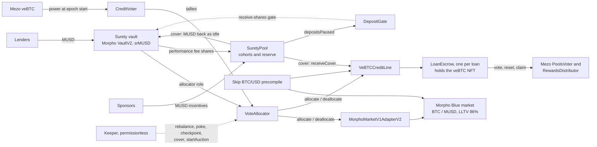

# Surety

Lending gauges for MUSD on Mezo: veBTC holders decide where a MUSD lending vault lends, and their own rewards are the first loss when a line they backed goes bad.

[App (Mezo testnet)](https://surety-credit.vercel.app) · [Architecture](docs/ARCHITECTURE.md) · [Security](docs/SECURITY.md) · [Proof](docs/PROOF.md) · [Claims](docs/CLAIMS.md)

In most money markets a curator picks where deposits go and loses nothing when a listing fails. Mezo described the alternative in [Aerodrome for lending](https://mezo.org/blog/aerodrome-for-lending): let vote-escrow holders steer lending the way gauges steer liquidity, so that votes become a price for risk. Surety builds that for MUSD credit. Lenders deposit MUSD into a Morpho VaultV2. Every epoch, veBTC holders split their voting power across credit lines, and the vault's capital follows the votes. Voters earn the vault's performance fee and sponsor incentives, but those rewards season for four epochs and are slashed first if a line they voted for records a loss; the pool's reserve comes second and lenders last. One of the lines lends MUSD against a locked veBTC NFT without unlocking it: the NFT sits in its own escrow and keeps voting and earning for the borrower.

Status: live on Mezo testnet (chain 31611, one-hour epochs, full lifecycle recorded) and deployed on Mezo mainnet (chain 31612) as a capped launch. The code has had an internal and an independent review, not an external audit.

## Review in 5 minutes

1. **Use the app.** Open [surety-credit.vercel.app](https://surety-credit.vercel.app) and choose **Open the credit board** (`/app`, Mezo testnet by default). Each line shows its vote share, allocation, target, utilisation, rates, cover capacity and uncovered loss. At the bottom of the board, the **Stress test** panel (testnet only) shows the BTC price the lines use and lets anyone apply a temporary haircut of up to 90% for up to 2 hours, which is how a bad-debt event is produced on demand. Applying one needs a wallet on Mezo testnet with a little BTC for gas; `/app?demo=1` shows every page on example data without a wallet. `/app/proof` lists the contracts and the recorded lifecycle transactions. Deposits on the testnet vault are paused for now, as the board and the Lend page show: VaultV2 is still recognising the covers from the run below, which takes about three weeks at the vault's size.
2. **Check the contracts.** All 14 contracts in [`contracts/deployments/31611.json`](contracts/deployments/31611.json) are verified on Sourcify with an exact match. Links for each are in [docs/PROOF.md](docs/PROOF.md#verified-contracts).
3. **Follow the loss on chain.** The lifecycle script ran on the current testnet deployment: a deposit, two votes, a rebalance, incentives, a veBTC loan and a Morpho borrow, then a −60% price shock. These are the transactions where the loss happens and is paid for. In each cover, the `CohortSlashed` events show the shares taken from voters and `Covered` shows the MUSD moved. Every transaction is in [docs/PROOF.md](docs/PROOF.md#live-lifecycle-on-testnet).

   <!-- proof:key-steps:start -->
   - Morpho liquidation leaves bad debt: [0x9fd3…0723](https://explorer.test.mezo.org/tx/0x9fd30e57406f16ef8c279011ec20f47b6783164579ad0f3668c06c5e1bec0723)
   - veBTC auction settles below the debt (shortfall): [0x32c4…79ad](https://explorer.test.mezo.org/tx/0x32c467bc1ee7b9b5ae1eef870c4f3f8e6149bfda4a381739dda646ffd23479ad)
   - Loss recorded on the Morpho line: [0x34c0…00a8](https://explorer.test.mezo.org/tx/0x34c07182444af905b13e4d22705d16d878bd0ab8c37ee1361b4851bef45f00a8)
   - Loss recorded on the veBTC line: [0x9aeb…da00](https://explorer.test.mezo.org/tx/0x9aebba4424e43ed91863469c282e7c251ae855fe1c1f5e54cdd61bec8844da00)
   - Cover: voter cohort slashed, MUSD returned to the vault: [0x7a52…8b03](https://explorer.test.mezo.org/tx/0x7a528516a84e5eebc6d6b32aa99103e7ec8bc2b0b7669457f82d01fd70188b03)
   - Cover: voter cohort slashed, MUSD paid into the veBTC line: [0xf260…ae9b](https://explorer.test.mezo.org/tx/0xf260dae6094b993d93781f3f6e202e93d76344047a39ff46f86fcaa2e9b4ae9b)
   - Next epoch: rebalance attributes interest to the cohorts: PENDING (not recorded yet)

   <!-- proof:key-steps:end -->

4. **Run the tests.**

   ```sh
   cd contracts && forge test      # 197 passed, 1 skipped (the opt-in mainnet fork suite)
   pnpm install && pnpm test       # 98 passed: sdk 53, keeper 37, mcp 8
   ```

## How it works

**Lend.** Lenders deposit MUSD into the Surety vault, a Morpho VaultV2, and receive srMUSD. The allocator keeps 10% of the vault's assets idle for withdrawals and covers. Withdrawals are never paused; an exit larger than the idle MUSD can use VaultV2's `forceDeallocate`, which pulls from a line's free liquidity for a 1% penalty paid to the remaining lenders.

**Vote.** Each epoch, a veBTC NFT can split its boosted voting power, read at the epoch start, across up to 10 credit lines. Votes cast in epoch t decide the vault's allocation from the first rebalance of epoch t+1. The rebalance is permissionless. It splits the deployable assets by votes, within the vault's caps, and moves capital through VaultV2's own `allocate` and `deallocate`.

**Underwrite.** Rewards for backing a line go into a cohort keyed by line and tally epoch: the vault's 10% performance fee on that line's interest, and any MUSD incentives sponsors post for the line's voters. A cohort is held as srMUSD and seasons until epoch t+6 (a two-epoch lag plus four epochs of seasoning). Until then, if the line records a loss, `cover` takes from that line's unmatured cohorts first, then from the shared reserve, and returns the MUSD to the vault or the line. Whatever the pool cannot cover stays with lenders. Matured cohorts are never slashed and are claimed pro rata to each NFT's votes.

**Borrow.** Two lines are live:

- *BTC / MUSD on Morpho Blue.* Borrowers post BTC on a Morpho market (LLTV 86%) priced by Mezo's Skip BTC/USD feed. Liquidations follow Morpho's own rules.
- *veBTC credit line.* Borrowers take MUSD against a locked veBTC NFT without unlocking it: up to 50% LTV on timed locks, 40% on permanent locks. Each loan's NFT sits in its own escrow, keeps voting on Mezo's gauges and earning fees, bribes and rebase for the borrower, and can be extended or topped up. At 70% LTV, or when a timed lock reaches its end, anyone can start a Dutch auction of the NFT. A sale below the debt is recorded as bad debt, which the pool covers.

## Architecture



The contracts, the epoch timeline, the loss waterfall and the exact cover sizing are described in [docs/ARCHITECTURE.md](docs/ARCHITECTURE.md).

## Built on Mezo

| Primitive | How Surety uses it |
| --- | --- |
| **MUSD** | The vault asset, the loan asset of both lines, and the currency of incentives, fees and covers. Valued at exactly $1. |
| **veBTC voting power** | `CreditVoter` weighs each ballot with `votingPowerOfNFTAt(tokenId, epochStart)`, the boosted power at the epoch start, so transfers, merges and new locks within the epoch add nothing. Weekly epochs flip on Thursday 00:00 UTC, like Mezo's. |
| **veBTC locks as collateral** | The veBTC line values `locked.amount` at the BTC/USD price and accepts only normal NFTs (no managed or grant locks). The NFT moves by plain `transferFrom` into a fresh escrow. |
| **PoolsVoter and RewardsDistributor** | Through its escrow, the borrower keeps voting Mezo's gauges (`vote`, `reset`), claims fees and bribes (`claimFeesAndBribes`) and the veBTC rebase (`RewardsDistributor.claim`); claims are forwarded to the borrower. |
| **Skip BTC/USD precompile** (`0x7b7c…0015`) | `SkipPriceSource` reads it with a 60-second maximum age, the bound MUSD's own price feed uses, and reverts on stale, non-positive or future-dated rounds. `MorphoPriceOracle` exposes it to Morpho. |
| **Morpho Blue and AdaptiveCurveIrm** | Mainnet uses Mezo's Morpho Blue ([`0x5658…A311`](https://explorer.mezo.org/address/0x565834cE7E40b8987BC20EbF83E2159467bDA311)) and IRM ([`0x3760…C1e7`](https://explorer.mezo.org/address/0x3760Ebc636F912a4dB9540fdA4Dec09C25C6C1e7)) at LLTV 86%, the only LLTV Mezo enables. Morpho is not deployed on Mezo testnet, so the deploy script deploys it there from the pinned sources. |
| **Morpho VaultV2 and MorphoMarketV1AdapterV2** | Vendored unmodified from `morpho-org/vault-v2` at commit `97bcce9`. The 13 source files of Mezo's verified VaultV2 ([`0x0629…6a8B`](https://explorer.mezo.org/address/0x06291b67e3d7660240ab44Afc9a708d82b976a8B)) and the 25 of its MorphoMarketV1AdapterV2 ([`0xb0EE…4F61`](https://explorer.mezo.org/address/0xb0EE3a01d9134733155B28289c09f084Acca4F61)) are identical to this tree. Surety's logic enters only through VaultV2's roles and hooks: allocator, performance-fee recipient, receive-shares gate and adapters. |
| **ERC4626VaultAdapter and vault gauges** (planned) | srMUSD is an ERC-4626 share, so Mezo's ERC4626VaultAdapter can wrap it and a governance call to `PoolsVoter.createVaultGauge` can pay MEZO emissions to lenders, the same wiring as Mezo's existing lending vault gauge. Not deployed: it needs Mezo governance. |

## Repository layout

```
contracts/          Foundry project
  src/              CreditVoter, VoteAllocator, SuretyPool, DepositGate
    lines/          VeBTCCreditLine, LoanEscrow, LinearKinkIrm
    oracles/        SkipPriceSource, MorphoPriceOracle, StressedPriceSource (testnet only)
    libraries/      EpochLib, LineIds
    interfaces/     Surety and Mezo interfaces
  script/           Deploy.s.sol (whole system), DeployMorphoStack.s.sol (Morpho on testnet)
  test/             unit, integration, invariant, audit (review regressions), fork (opt-in)
  deployments/      <chainId>.json: addresses, lines and recorded proof transactions
  lib/              forge-std, OpenZeppelin, morpho-blue, morpho-blue-irm, vault-v2 (submodules)
packages/sdk/       @surety/sdk: typed reads and unsigned transaction builders (viem)
packages/mcp/       @surety/mcp: MCP server over the SDK; returns unsigned calldata, holds no keys
keeper/             @surety/keeper: permissionless keeper, plus the testnet lifecycle script
apps/web/           Next.js app: landing, credit board, vote, lend, borrow, sponsor, auctions, proof
docs/               architecture, security, proof and claims
```

## Quick start

Requirements: Foundry 1.x, Node 22.18 or later, pnpm 9.15.

### Contracts

```sh
git submodule update --init
git -C contracts/lib/vault-v2 submodule update --init lib/morpho-blue lib/morpho-blue-irm
git -C contracts/lib/vault-v2/lib/morpho-blue-irm submodule update --init lib/morpho-blue
git -C contracts/lib/morpho-blue-irm submodule update --init lib/morpho-blue

cd contracts
forge build
forge test                                             # 197 passed, 1 skipped
SURETY_FORK=true forge test --match-contract LiveMezo  # against live Mezo mainnet state
```

Initialise only the nested submodules above: a recursive checkout pulls test dependencies the build does not need, and their paths are too long for a default Windows setup.

### TypeScript packages

```sh
pnpm install
pnpm build    # sdk (bundles contracts/deployments), keeper, mcp, web
pnpm test     # vitest in sdk, keeper and mcp
```

### Keeper

```sh
pnpm keeper --chain 31611 --dry-run --once      # simulate one pass, send nothing
KEEPER_PRIVATE_KEY=0x... pnpm keeper --chain 31611
```

It pokes ballots after each flip, rebalances once per epoch, checkpoints and covers losses, and starts auctions. It holds no role; every call it makes is open to anyone. Flags and logs: [keeper/README.md](keeper/README.md).

### MCP server

```sh
pnpm mcp                        # stdio, testnet
pnpm mcp --http --port 3333     # streamable HTTP at http://127.0.0.1:3333/mcp
```

Tools: the credit board, the epoch, veBTC borrow quotes, loan health, an NFT's cohorts, and unsigned transactions for the user and keeper actions. Details: [packages/mcp/README.md](packages/mcp/README.md).

### Web app

```sh
pnpm --filter web dev           # http://localhost:3000
```

### Deploy

```sh
cd contracts
STRESS=true forge script script/Deploy.s.sol --rpc-url mezo_testnet --broadcast --verify   # testnet stress deployment
forge script script/Deploy.s.sol --rpc-url mezo_mainnet --broadcast --verify               # mainnet
```

One run deploys and wires everything, ends the line-listing bootstrap, raises the timelocks and writes `deployments/<chainId>.json`. Without `--broadcast` it is a dry run that writes `deployments/dry-run/<chainId>.json`. Every variable is optional:

| Variable | Testnet default | Mainnet default | Meaning |
| --- | --- | --- | --- |
| `DEPLOYER_KEY` | | | Key to broadcast with; otherwise `--sender` / `--account` |
| `STRESS` | `false` | refused | Price the lines through `StressedPriceSource`, which anyone can shock |
| `EPOCH_LENGTH` | 3600 | 604800 | Epoch length in seconds |
| `MUSD`, `BTC`, `VEBTC`, `POOLS_VOTER`, `REWARDS_DISTRIBUTOR`, `SKIP_AGGREGATOR` | Mezo testnet | Mezo mainnet | Mezo contract addresses |
| `MORPHO`, `MORPHO_IRM` | unset: deploy the pinned stack | Mezo's | Morpho Blue and AdaptiveCurveIrm; set both or neither |
| `MORPHO_CAP`, `LINE_CAP` | 10,000,000 MUSD | 2,000 MUSD | Absolute caps on the Morpho ids and the veBTC line ids, in MUSD wei; relative caps are 100% |
| `AUCTION_DURATION` | 600 | 21600 | Seconds for the auction price to decay to its floor |
| `MIN_TERM` | 3600 | 259200 | Lock time a timed lock must have left to borrow |
| `VAULT_TIMELOCK` | 0 | 86400 | Timelock on every curator function of the vault and the Morpho adapter, and the CreditVoter's line timelock (0 is refused on mainnet) |
| `SIMULATE_PRECOMPILES`, `SKIP_PRICE` | `false` | `false` | Dry runs on a local fork only: replace the Skip precompile with a settable mock |
| `DEPLOYMENT_OUT` | | | Output path override |

## Deployments

**Mezo testnet (31611)**, deployed at block 16,327,001 with `STRESS=true`, 1-hour epochs and no timelocks. Explorer: [explorer.test.mezo.org](https://explorer.test.mezo.org).

| Contract | Address |
| --- | --- |
| Surety vault (VaultV2, srMUSD) | [`0xdb2526679a0F285aEF9B31507364c4DD8CE59481`](https://explorer.test.mezo.org/address/0xdb2526679a0F285aEF9B31507364c4DD8CE59481) |
| MorphoMarketV1AdapterV2 | [`0x3Dc62001022DdeBf0C8963dDEbC584f5d9635c63`](https://explorer.test.mezo.org/address/0x3Dc62001022DdeBf0C8963dDEbC584f5d9635c63) |
| CreditVoter | [`0x3e9D39CeF152006831574b604435D22fAd631304`](https://explorer.test.mezo.org/address/0x3e9D39CeF152006831574b604435D22fAd631304) |
| VoteAllocator | [`0x66541B50a2F5bF7cFFcF623Fa02386e282cDe0E9`](https://explorer.test.mezo.org/address/0x66541B50a2F5bF7cFFcF623Fa02386e282cDe0E9) |
| SuretyPool | [`0xEF54E2e74118B0ea58Eb422660cdd902352aB357`](https://explorer.test.mezo.org/address/0xEF54E2e74118B0ea58Eb422660cdd902352aB357) |
| DepositGate | [`0x202129dF9f6Ebd83f508bc34D6C20F41fDCa22b2`](https://explorer.test.mezo.org/address/0x202129dF9f6Ebd83f508bc34D6C20F41fDCa22b2) |
| VeBTCCreditLine | [`0x11A87EA0E77261Eedd2C8F2f27B0bB4D6391bE68`](https://explorer.test.mezo.org/address/0x11A87EA0E77261Eedd2C8F2f27B0bB4D6391bE68) |
| LoanEscrow implementation | [`0x5480eC4D37Fe1eb31793d7FEC4BE6B3Ab3806417`](https://explorer.test.mezo.org/address/0x5480eC4D37Fe1eb31793d7FEC4BE6B3Ab3806417) |
| LinearKinkIrm (veBTC line) | [`0x3195fe2Ff429DeC76389947c36A093fd14839949`](https://explorer.test.mezo.org/address/0x3195fe2Ff429DeC76389947c36A093fd14839949) |
| StressedPriceSource (lines' price) | [`0xf57424252c4D4EB015c0f1851a4D64EF5D84150F`](https://explorer.test.mezo.org/address/0xf57424252c4D4EB015c0f1851a4D64EF5D84150F) |
| SkipPriceSource | [`0x5b2889271154adD90BC4b33EaE3Bb5dDC09d6BFC`](https://explorer.test.mezo.org/address/0x5b2889271154adD90BC4b33EaE3Bb5dDC09d6BFC) |
| MorphoPriceOracle | [`0x7fe38beE73412FFC05263606Bc0caD7bB7632e06`](https://explorer.test.mezo.org/address/0x7fe38beE73412FFC05263606Bc0caD7bB7632e06) |
| Morpho Blue (pinned sources) | [`0xF191f133ecCC997D36713A6c4ee64c24E7e261Ef`](https://explorer.test.mezo.org/address/0xF191f133ecCC997D36713A6c4ee64c24E7e261Ef) |
| AdaptiveCurveIrm (pinned sources) | [`0x8Fa08ff73618EC1ac3844a975d5Ee41b96f45028`](https://explorer.test.mezo.org/address/0x8Fa08ff73618EC1ac3844a975d5Ee41b96f45028) |

Lines: 0 is BTC / MUSD on Morpho (market `0x025a6a60…c4455`), 1 is the veBTC credit line. Mezo contracts used: MUSD `0x1189…c503`, BTC `0x7b7C…0000`, veBTC `0x38E3…130a`, PoolsVoter `0x263F…5F0D`, RewardsDistributor `0x9050…7442`, Skip BTC/USD `0x7b7c…0015`; full addresses in the deployment file.

**Mezo mainnet (31612)**: live as a capped launch, deployed and verified on 2026-10-25 (block 12755630). All 11 Surety contracts are an exact match on Sourcify. It uses Mezo's own Morpho Blue ([`0x5658…A311`](https://explorer.mezo.org/address/0x565834cE7E40b8987BC20EbF83E2159467bDA311)) and AdaptiveCurveIrm ([`0x3760…C1e7`](https://explorer.mezo.org/address/0x3760Ebc636F912a4dB9540fdA4Dec09C25C6C1e7)), the plain Skip price source (no stress knob), weekly epochs on Mezo's Thursday flip, caps of 2,000 MUSD per line, 1-day timelocks on every vault curator function and on the Morpho adapter, and a 1-day timelock on listing new lines. No deposits yet.

| Contract | Address | Verified |
| --- | --- | --- |
| Surety MUSD vault (VaultV2) | [`0x632d627b66F2b11C8d0Fc61790422B0931D145de`](https://explorer.mezo.org/address/0x632d627b66F2b11C8d0Fc61790422B0931D145de) | [Sourcify](https://repo.sourcify.dev/31612/0x632d627b66F2b11C8d0Fc61790422B0931D145de) |
| MorphoMarketV1AdapterV2 | [`0xcB92a383a238Ce68d7b8Fe17231c90465379F779`](https://explorer.mezo.org/address/0xcB92a383a238Ce68d7b8Fe17231c90465379F779) | [Sourcify](https://repo.sourcify.dev/31612/0xcB92a383a238Ce68d7b8Fe17231c90465379F779) |
| CreditVoter | [`0x7B6673dEbB5E2480798ff3e11680182F37aF2f4f`](https://explorer.mezo.org/address/0x7B6673dEbB5E2480798ff3e11680182F37aF2f4f) | [Sourcify](https://repo.sourcify.dev/31612/0x7B6673dEbB5E2480798ff3e11680182F37aF2f4f) |
| VoteAllocator | [`0x810e269c6ae8198d92eda674B02daB4CF7a05CEE`](https://explorer.mezo.org/address/0x810e269c6ae8198d92eda674B02daB4CF7a05CEE) | [Sourcify](https://repo.sourcify.dev/31612/0x810e269c6ae8198d92eda674B02daB4CF7a05CEE) |
| SuretyPool | [`0x0597c0aB730BE64DDf797dE999275b627D9e592f`](https://explorer.mezo.org/address/0x0597c0aB730BE64DDf797dE999275b627D9e592f) | [Sourcify](https://repo.sourcify.dev/31612/0x0597c0aB730BE64DDf797dE999275b627D9e592f) |
| DepositGate | [`0xE708dba05AC671456F6258328794a25D8A352205`](https://explorer.mezo.org/address/0xE708dba05AC671456F6258328794a25D8A352205) | [Sourcify](https://repo.sourcify.dev/31612/0xE708dba05AC671456F6258328794a25D8A352205) |
| VeBTCCreditLine | [`0xb12ec34B417afB511A5067B31A32c65084FeE723`](https://explorer.mezo.org/address/0xb12ec34B417afB511A5067B31A32c65084FeE723) | [Sourcify](https://repo.sourcify.dev/31612/0xb12ec34B417afB511A5067B31A32c65084FeE723) |
| LoanEscrow implementation | [`0x1F2Fac07338B7a98B80622e436346fae13B66BE7`](https://explorer.mezo.org/address/0x1F2Fac07338B7a98B80622e436346fae13B66BE7) | [Sourcify](https://repo.sourcify.dev/31612/0x1F2Fac07338B7a98B80622e436346fae13B66BE7) |
| LinearKinkIrm (veBTC line) | [`0x023091B88CE266BF841868D30AE88D767Bd8fA5b`](https://explorer.mezo.org/address/0x023091B88CE266BF841868D30AE88D767Bd8fA5b) | [Sourcify](https://repo.sourcify.dev/31612/0x023091B88CE266BF841868D30AE88D767Bd8fA5b) |
| SkipPriceSource (lines’ price) | [`0x2f72e9EEBBF8ffB9bb27c1Efd562bA3B3f2345ba`](https://explorer.mezo.org/address/0x2f72e9EEBBF8ffB9bb27c1Efd562bA3B3f2345ba) | [Sourcify](https://repo.sourcify.dev/31612/0x2f72e9EEBBF8ffB9bb27c1Efd562bA3B3f2345ba) |
| MorphoPriceOracle | [`0x1cc8daeb91B7da756E3eA1f51eAB8c0776f0cb9B`](https://explorer.mezo.org/address/0x1cc8daeb91B7da756E3eA1f51eAB8c0776f0cb9B) | [Sourcify](https://repo.sourcify.dev/31612/0x1cc8daeb91B7da756E3eA1f51eAB8c0776f0cb9B) |

Lines: 0 is BTC / MUSD on Mezo's Morpho Blue (market `0x29c2a844…d6707`), 1 is the veBTC credit line.

## Tests

| Suite | Tests | What it covers |
| --- | --- | --- |
| Foundry unit | 183 | Every contract, plus the Mezo mocks and the shared fixture; fuzzed inputs run 512 times |
| Foundry integration | 3 | Wiring as deployed, a full happy-path cycle and a full bad-debt cycle on real Morpho Blue, AdaptiveCurveIrm and VaultV2 bytecode |
| Foundry invariant | 1 suite, 7 invariants | 256 runs of 64 random lender, voter, sponsor, borrower, liquidator, price-shock and keeper actions; any revert fails the run |
| Foundry review regressions | 10 | One test per fixed review finding (9) and one verified non-issue |
| Foundry fork | 1 (skipped by default) | Surety deployed against live Mezo mainnet state; run with `SURETY_FORK=true` |
| TypeScript | 98 | SDK client, builders, deployments and math (53); keeper decisions, passes and runtime (37); MCP tools over in-memory and HTTP transports (8) |

Forge reports 197 passed and 1 skipped; it counts the invariant suite as one test.

## Security

The contracts went through an internal review, an independent review backed by Foundry proofs of concept, and Slither. The independent review reported 4 medium, 6 low and 7 informational findings and no critical or high ones. All 4 medium and 5 of the 6 low findings are fixed, each with a regression test; the remaining low one (draining the veBTC line's cash raises its borrow rate until the next rebalance) is acknowledged and handled by the keeper. Scope, every finding, the fixes, verified non-issues, residual risks and the privileged roles are in [docs/SECURITY.md](docs/SECURITY.md).

## Limits

- **Owner keys.** On testnet the deployer key is the vault's owner, curator and sentinel, the owner of every Surety contract and the owner of the testnet Morpho Blue, and every timelock is zero. All owner roles should move behind a timelock and a multisig before caps rise.
- **Deposits can pause for days.** New vault shares wait while a loss is unrecorded or uncovered and while VaultV2 re-recognises the MUSD a cover returned. Recognition runs at most at VaultV2's maximum rate of 200% a year, so MUSD worth 10% of the vault's assets takes about 18 days. Withdrawals stay open throughout.
- **Large exits wait or pay.** Withdrawals are paid from idle MUSD. A larger exit waits for the next rebalance to refill the buffer, or uses `forceDeallocate` for a 1% penalty, limited by the lines' free liquidity.
- **Lenders are restored gradually.** A loss lowers the share price at once; the cover that restores it is recognised under VaultV2's `maxRate`, not in one step.
- **Morpho losses are measured, not reported.** A Morpho line's bad debt is read from a high-water mark of the market's supply share price, taken at every checkpoint. A loss before a line's first checkpoint is not recorded, and a forced exit before the bad debt in the same window over-records, which favours lenders.
- **Auctions need bidders.** A veBTC auction decays to a floor of 70% of the live collateral value and waits there. Without a bid the loan stays in auction and nothing settles. Morpho liquidations rely on Morpho liquidators; the keeper's backstop is off by default.
- **MUSD is priced at $1** in both oracles. A stale Skip feed fails closed, which also blocks Morpho liquidations until the feed recovers.
- **A listed line is trusted.** A malicious line that clears both timelocks (VaultV2's `addAdapter` and the CreditVoter's line timelock) could still report interest it did not earn and draw voter fees. The loss it can make the pool cover is bounded by what the vault allocated to it.
- **Voters are exposed beyond their line.** Cohorts are held as srMUSD, so they also take their share of any loss lenders bear on other lines.
- **Mezo dependencies are upgradeable.** veBTC and PoolsVoter are proxies; a change to their custody or voting-power semantics would need a review of the escrow and the voter.

## Roadmap

- A real Mezo vault gauge for srMUSD through governance, using Mezo's ERC4626VaultAdapter, so lenders earn MEZO emissions.
- MEZO-denominated incentives next to MUSD ones.
- Self-repaying veBTC loans: the escrowed NFT's fees, bribes and rebase repay the debt.
- Every owner role behind a multisig and a timelock.
- An external audit before caps rise.
- More collateral lines.

## License

MIT for Surety's own code ([LICENSE](LICENSE)). Vendored dependencies keep their licenses: VaultV2, MorphoMarketV1AdapterV2 and Morpho Blue are GPL-2.0-or-later, AdaptiveCurveIrm and OpenZeppelin are MIT, forge-std is MIT or Apache-2.0.
