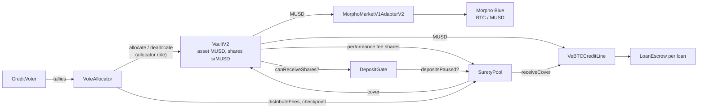
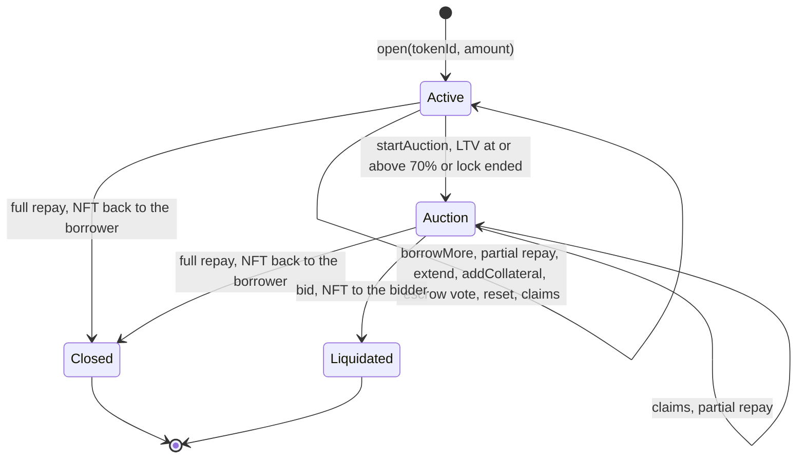

# Architecture

Surety is one MUSD lending vault whose allocation is decided by veBTC votes, a pool that holds the voters' rewards as first loss, and two credit lines the vault lends through. This document covers each contract, the epoch timeline, the loss waterfall and how a cover is sized, the deposit gate, the veBTC loan lifecycle, the oracles, and the vault configuration as deployed. Addresses are in the [README](../README.md#deployments) and in `contracts/deployments/<chainId>.json`.



## Contracts

### Surety vault: Morpho VaultV2

**Purpose.** Holds lenders' MUSD and issues srMUSD shares. It is Morpho's VaultV2, vendored unmodified (`contracts/lib/vault-v2` at `97bcce9`, the same sources as Mezo's own VaultV2 on mainnet). Surety adds no code to it; every Surety contract acts through a role or hook VaultV2 already has.

**How Surety plugs in.**

- The `VoteAllocator` is the only allocator. It moves MUSD between the vault and its two adapters with `allocate` and `deallocate`, and sets `maxRate`.
- The `SuretyPool` is the performance-fee recipient. The fee is 10% of the vault's interest, minted as srMUSD.
- The `DepositGate` is the receive-shares gate. The send-shares, receive-assets and send-assets gates are unset, so exits are never gated.
- Adapters: `MorphoMarketV1AdapterV2` (Morpho's own adapter, for Morpho lines) and `VeBTCCreditLine`.
- No liquidity adapter is set. Withdrawals are paid from idle MUSD, which the allocator keeps at 10% of total assets; a larger exit uses VaultV2's permissionless `forceDeallocate`, which moves assets from an adapter to idle for a 1% penalty paid to the remaining holders.

**Trust.** VaultV2's accounting: losses are realised at once, gains (interest, donations, covers) are recognised no faster than `maxRate`, and caps, timelocks and gates are enforced as Morpho documents them.

### CreditVoter

**Purpose.** The lending gauges. Each epoch, veBTC NFTs split their voting power across credit lines, and the tallies decide each line's share of the vault.

**Key functions.**

- `vote(tokenId, lineIds, weightsBps)`: by the NFT's owner or an approved address. Up to 10 distinct active lines, each weight non-zero, summing to 10,000 bps. The NFT's power is `veBTC.votingPowerOfNFTAt(tokenId, epochStart)`, its boosted power at the start of the epoch; zero power reverts. A second ballot from the same NFT in the same epoch replaces the first.
- `poke(tokenId)`: permissionless. Recasts the NFT's stored ballot into the current epoch at the new snapshot. Lines deactivated since are dropped and the remaining weights rescaled to 10,000. Reverts when the ballot is already current, when none of its lines is active, and for a burned NFT.
- `addLine` (bootstrap only), `endBootstrap`, `proposeLine` and `executeLine` (after `LINE_TIMELOCK`), `setLineActive`, `setEscrowRegistry` (once).
- Views: `currentEpoch`, `line`, `lineCount`, `lineVotes(epoch, lineId)`, `totalVotes(epoch)`, `tokenVotes(epoch, tokenId, lineId)`, `ballotOf`.

**Invariants.**

- Per epoch, the line tallies sum to the epoch total, and each line's tally is the sum of its ballots; the rounding remainder of a split goes to the ballot's last line, so an NFT's tallies sum to exactly its power.
- Only the current epoch is ever written, so a closed epoch's tally is final.
- One snapshot per NFT per epoch: power is read at the epoch start, so a lock created, merged into or transferred during the epoch adds nothing until the next one. Ballots are refused during an epoch's first second, when a veBTC checkpoint written in the same block could still move the snapshot.
- NFTs held by a Surety loan escrow cannot vote or be poked, so a borrower cannot vote credit toward their own line with collateral.
- Lines are never removed, only deactivated. A Morpho line must use the vault's Morpho adapter with canonical market parameters that lend MUSD under the adapter's IRM; a veBTC line must report `vault()` equal to the Surety vault. Each market and each veBTC adapter can be listed once, and every adapter must already be a vault adapter.

**Trust.** veBTC's `votingPowerOfNFTAt`, `ownerOf` and `isApprovedOrOwner`. The owner lists lines: instantly only during the bootstrap, which the deploy script ends right after listing lines 0 and 1, then through `proposeLine` and `executeLine` after `LINE_TIMELOCK` (0 on testnet, 1 day on mainnet; the constructor refuses 0 on Mezo mainnet). `setLineActive` takes effect at once: an inactive line takes no new ballots or pokes, and its target drops to zero at the next rebalance.

### VoteAllocator

**Purpose.** Holds the vault's allocator role, turns tallies into allocations, and measures each line's interest so the pool can split voter fees by line.

**Key functions.**

- `rebalance()`: permissionless and safe to repeat. In order:
  1. Accrue the vault. Have the pool checkpoint every line's losses; a failing checkpoint is reported (`CheckpointFailed`) and skipped.
  2. Measure each line's interest since the last snapshot and add it to the line's pending interest.
  3. On the first rebalance of an epoch, fix the tally epoch: the previous epoch if any active line got votes in it, otherwise the current one (bootstrap, which follows the live tally until an epoch closes with votes). Oracle liveness plays no part in this choice.
  4. Set targets. `deployable = totalAssets × (1 − 10%)` is split over active lines by votes. Each share is capped by the room the VaultV2 absolute and relative caps of its ids leave once the other lines have given back what they hold above their own shares. An active line that cannot take new money (stale oracle, paused veBTC line, or a line whose calls revert) is held at `min(current, target)`. Inactive and unvoted lines target zero.
  5. Deallocate overweight lines, bounded by what they can pay now (Morpho market liquidity, the veBTC line's cash). Then allocate to underweight lines from idle MUSD above the buffer, in line order, re-reading the caps before each move. A move the vault rejects is reported (`MoveFailed`) and skipped. Gaps under one billionth of a target are left alone.
  6. Checkpoint every line again, so the pool's Morpho mark reflects the shares this run left in the market.
  7. Snapshot each line: for Morpho lines, the adapter's supply shares and the market's supply share price; for the veBTC line, its `interestEarnedTotal()`.
  8. On the first rebalance of an epoch, hand the pending interest of every line to `SuretyPool.distributeFees(cohortEpoch, lineIds, interest)`, where `cohortEpoch` is the tally epoch that drove the allocation until now. The very first rebalance after deployment only sets the baseline.
- `setSuretyPool` (once) and `setMaxRate` (at most VaultV2's `MAX_MAX_RATE`, 200% a year).
- Views: `targets()`, `lineAssets(lineId)`, `ledger(lineId)`, `activeTallyEpoch`, `lastRebalanceEpoch`.

**How interest is measured.** Never from changes in a line's assets, because anyone can move those with `forceDeallocate`, and covers and losses move them too. A Morpho line earns `sharesAtSnapshot × (sharePriceNow − sharePriceAtSnapshot)`, computed with Morpho's share math on the accrued market. Only interest raises Morpho's supply share price and only bad debt lowers it, so nobody else's deposits or withdrawals change the result, and a drop measures zero (the pool treats it as a loss). The veBTC line earns the increase of its cumulative interest counter.

**Invariants.** Holds no MUSD and no srMUSD. The only capital moves are VaultV2 `allocate` and `deallocate` with the adapter and data the CreditVoter lists for a line; VaultV2 rejects anything that is not its adapter and enforces the caps.

**Trust.** The CreditVoter's line list and tallies. A veBTC line's own calls (`ids`, `paused`, `oracle`, `cash`, `interestEarnedTotal`) are guarded, so a line whose calls revert only makes itself ineligible. The owner's `setMaxRate` takes effect at once; it should stay at the maximum, since a lower rate slows the recognition of covers.

### SuretyPool

**Purpose.** Holds the voters' rewards as first loss. Rewards for backing a line sit in cohorts keyed by (line, tally epoch), as srMUSD that keeps compounding inside the vault. A cohort is slashed first when its line records a loss; after it matures it is claimed by the NFTs that voted.

**Key functions.**

- `postIncentive(lineId, assets)`: a sponsor's MUSD is deposited into the vault and joins cohort (line, current epoch).
- `refundIncentive(lineId, epoch)`: after the epoch ends, a sponsor of a line that drew no votes in it gets back its pro-rata part of what is left of the cohort.
- `distributeFees(cohortEpoch, lineIds, interest)`, allocator only. Takes the srMUSD the pool received since the last call (the performance fee, plus anything sent to it directly). First it credits the fee shares that VaultV2 minted on re-recognised cover MUSD back to the cohorts those covers slashed (see below). The rest is split across lines pro rata to their interest and goes to cohort (line, `cohortEpoch`) when the line had votes in that epoch; everything else goes to the reserve.
- `claim(tokenId, lineId, epoch)`: permissionless, after maturity. Pays `finalShares × tokenVotes / lineVotes`, where `finalShares` is frozen at the cohort's first claim. The shares go to the NFT's owner, to the borrower when the owner is a Surety loan escrow, or to the reserve when the NFT was burned (merged or withdrawn).
- `checkpoint(lineId)`: permissionless; records any new loss (below).
- `cover(lineId)`: permissionless and repeatable; checkpoints, then covers as much of the line's uncovered loss as the pool and the vault's idle MUSD allow (below).
- `setAllocator`, once. The owner has no other power.
- Views: `cohort`, `maturityOf(epoch)`, `claimable`, `uncoveredLoss`, `coverCapacity`, `depositsPaused`, `lossRecorded`, `lossCovered`, `reserveShares`, `highWaterMark`.

**Invariants.**

- `lossCovered ≤ lossRecorded` for every line.
- The shares in cohorts plus the reserve equal the pool's accounted shares, and every share that entered a cohort is claimed, slashed, refunded or still held.
- Shares leave the pool only to a claimant, a refunded sponsor, or (redeemed as MUSD) to the vault or line being covered.
- At most `SEASON + 2` cohorts per line are unmatured. Matured cohorts take no inflows, so their share count at maturity is final.
- The reserve is never claimable.

**Trust.** VaultV2 (share prices, `previewWithdraw`, `withdraw`), the CreditVoter's tallies, Morpho Blue's market accounting, and the veBTC line's `badDebtTotal`. A line's recorded loss is bounded by what the vault allocated to it, which caps what a misbehaving line could make the pool pay.

### DepositGate

**Purpose.** The vault's receive-shares gate. It holds new srMUSD back while `SuretyPool.depositsPaused()` is true, so nobody can buy in at the depressed price after a loss and capture the voter-funded cover meant for the lenders who took it. Rules are in [Deposit gate](#deposit-gate).

**Key function.** `canReceiveShares(account)`: always true for the pool; otherwise `!pool.depositsPaused()`, and false if that view reverts. It never reverts, as VaultV2 requires of gates.

**Trust.** Assumes the pool stays the vault's performance-fee recipient: VaultV2 asks the gate about the fee recipient during every accrual, so the pool's own answer must not depend on `depositsPaused`.

### VeBTCCreditLine

**Purpose.** Lends MUSD against locked veBTC NFTs without unlocking them. It is both a VaultV2 adapter (the vault allocates MUSD into it and deallocates idle cash out) and a small isolated lending market. Each loan's NFT sits in its own `LoanEscrow` clone.

**Key functions.**

- Adapter: `allocate` and `deallocate` (vault only; lent-out MUSD cannot be deallocated), `ids()` (the adapter id and the veBTC collateral id), `realAssets() = cash + totalDebt` with interest up to the current second, `receiveCover(assets)` (pool only).
- Borrowing: `open(tokenId, amount)`, `borrowMore`, `repay` (anyone, partial or full), `extend`, `addCollateral`.
- Escrow actions, borrower only: `escrowVote`, `escrowReset`, `escrowClaim`, `escrowClaimRebase`.
- Liquidation: `startAuction`, `auctionPrice`, `bid`.
- Owner: `pause(bool)` for new borrowing, `setSuretyPool` once.
- Views: `loan`, `debtOf`, `totalDebt`, `healthOf`, `maxBorrow`, `utilizationWad`, `interestEarnedTotal`, `badDebtTotal`, `isEscrow`, `borrowerOfEscrow`.

**Parameters as deployed.** Max LTV 50% for timed locks and 40% for permanent locks; liquidation at 70% LTV; 3% liquidation fee; auction floor 70% of collateral value; auction decay 10 minutes on testnet, 6 hours on mainnet; minimum remaining lock time to borrow 1 hour on testnet, 3 days on mainnet. Collateral value is `locked.amount × BTC/USD`, with MUSD at $1 and lock boosts ignored.

**Invariants.**

- `realAssets == cash + totalDebt`, the line's MUSD balance covers `cash`, and per-loan debts sum to `totalDebt` within one wei per open loan.
- `badDebtTotal` never decreases; covers add cash instead.
- Every open loan's escrow holds its NFT; a settled loan's escrow holds nothing.
- Rounding favours lenders: borrowing mints normalised debt rounded up, partial repayment burns it rounded down, and debts round up.
- `interestEarnedTotal` (interest through the borrow index plus liquidation fees kept) only grows, and capital entering or leaving the line does not move it.

**Trust.** The price source, veBTC's lock data, and the vault. The owner can pause new borrowing; it cannot move NFTs or MUSD.

**Utilisation and forced exits.** Utilisation is `debt / (cash + debt)` on the line's own cash. Anyone can pull that cash out with `forceDeallocate` (paying the 1% penalty to lenders). Utilisation then reads 100%: every borrower accrues at the curve's maximum APR and new loans revert until the allocator refills the line. The keeper rebalances at every epoch flip and can rebalance mid-epoch when the line's cash falls well below its target.

### LoanEscrow

**Purpose.** Custodies the veBTC NFT of exactly one loan. Deployed as an OpenZeppelin `Clones` proxy per loan, so no NFT ever shares custody with another.

**Key functions.** `initialize` (once, by the line, in the transaction that creates the clone; the implementation is locked at construction), `release(to)`, `vote`, `reset`, `claimRewards`, `claimRebase`, `extend`, `increaseAmount`. All but `initialize` are callable by the line only, and the line calls them only for the loan's borrower or its own settlement.

**Invariants.** Every target (veBTC, PoolsVoter, RewardsDistributor, BTC) is fixed at initialisation. There is no generic call or execute, no meta-transaction support, no `onERC721Received` and no payable entry point. The NFT arrives by plain `transferFrom` and leaves only through `release`. `claimRewards` forwards only the balance increase of each listed token, measured on live balances, and never treats the veBTC contract as a token.

**Trust.** Mezo's veBTC, PoolsVoter and RewardsDistributor behave as their verified sources do.

### LinearKinkIrm

Borrow APR of the veBTC line as a function of utilisation: 2% at 0%, rising linearly to 8% at 80% utilisation, then to 60% at 100%. Applied per second as simple interest between accruals. APRs above 1000% are refused at construction.

### Price sources

- `SkipPriceSource`: BTC/USD from Mezo's Skip precompile (`0x7b7c…0015`, Chainlink interface), normalised to 18 decimals. Every read checks that the feed still reports 18 decimals and reverts on a non-positive answer, a future-dated round, or a round older than 60 seconds.
- `StressedPriceSource` (testnet stress deployment only): wraps a price source and lets anyone apply a haircut of up to 90% for up to 2 hours; a new shock replaces the current one, and the haircut disappears when it expires. The deploy script refuses it on mainnet.
- `MorphoPriceOracle`: the Morpho Blue oracle for the BTC / MUSD market: the BTC price in MUSD at Morpho's 1e36 scale, with MUSD at $1. Reverts from its source propagate.

### Libraries

- `EpochLib`: an epoch's id is its start timestamp, `t − (t mod length)`. Unix time 0 was a Thursday 00:00 UTC, so weekly epochs flip on Thursdays like Mezo's.
- `LineIds`: VaultV2 cap ids, encoded exactly as `MorphoMarketV1AdapterV2` encodes them: per adapter (`"this"`), per collateral token (`"collateralToken"`) and per Morpho market (`"this/marketParams"`).

## Epoch timeline

Epochs are 1 hour on testnet and 1 week on mainnet. `SEASON` is 4 epochs. For a tally epoch `t` and a line `L`:

| Epoch | What happens |
| --- | --- |
| `t` | Ballots are cast at the power each NFT had at the start of `t`. Sponsor incentives posted during `t` join cohort `(L, t)`. The cohort is already slashable while `L` has votes in `t`. |
| `t+1` | The first rebalance of `t+1` fixes tally `t`, and the vault's allocation follows it for the whole epoch. Each rebalance measures the interest every line earned since the last one. |
| `t+2` | The first rebalance of `t+2` hands the interest earned while tally `t` drove the allocation to `distributeFees(t, …)`. The fee shares go to the cohorts `(L, t)` pro rata to each line's interest. |
| `t+2` to `t+5` | Cohort `(L, t)` seasons and is slashed first when `L` records a loss. |
| `t+6` | `maturityOf(t) = t + (2 + SEASON) × epochLength`. From here the cohort takes no inflows, is never slashed, and can be claimed. |

So a cohort matures 6 hours after its epoch starts on testnet and 6 weeks after on mainnet. While tally `t` drives the allocation during `t+1`, voters are already casting tally `t+1`.

## Loss waterfall

### Recording a loss

`checkpoint(lineId)` records new loss; the allocator calls it for every line before and after each rebalance, and anyone else can call it at any time.

- **Morpho lines.** The pool accrues the market and compares its supply share price, `(totalSupplyAssets + 1) / (totalSupplyShares + 1e6)` with Morpho's virtual amounts, with the mark set at the line's last checkpoint. A drop is valued on `max(sharesAtMark, sharesNow)` of the adapter's supply shares: shares that left after the mark (through a `forceDeallocate`, possibly in the same transaction as the liquidation that made the bad debt) left at the impaired price, so their part of the loss is real for the vault and is recorded too. Drops worth at most `LOSS_DUST` (1e12 wei, 0.000001 MUSD) are ignored; Morpho's share price never falls through rounding, so any drop is bad debt. The mark then moves to the current price and shares, so a line that held no shares never carries a stale price into its next position. A loss before a line's first checkpoint is not measured; the deploy script checkpoints the Morpho line once.
- **veBTC line.** The increase of the line's cumulative `badDebtTotal` since the last checkpoint.
- **Bound.** A checkpoint never records more than the larger of the vault's allocation to the line's adapter now and at the line's previous checkpoint, so a forced exit between the loss and its checkpoint cannot shrink the bound either.

### Who pays

When `cover(lineId)` runs, the uncovered loss is paid in this order:

1. **The line's unmatured, backed cohorts**: every cohort `(L, e)` for the current epoch and the `SEASON + 1` epochs before it that holds shares and whose line had votes in `e`. They pay pro rata to their holdings.
2. **The reserve**: fee shares that could not be attributed to a voted line, rounding, claims of burned NFTs, and the reserve's share of returned cover fees.
3. **Lenders**: whatever the pool cannot cover stays in the share price.

`cover` withdraws the MUSD from the vault by burning the pool's shares. For a Morpho line the MUSD goes back to the vault as idle assets (a Morpho supply made on the adapter's behalf would not be on the adapter's own share ledger and would be stranded); for the veBTC line it is paid in through `receiveCover`. The MUSD moved is at most what the pool's slashable shares redeem for and at most the vault's idle MUSD, so a cover larger than the idle MUSD completes over several calls as idle MUSD comes back. `cover` is permissionless and safe to repeat.

### Sizing a cover

VaultV2 realises a loss at once but books the MUSD a cover returns as a gain: it recognises it no faster than `maxRate` and mints its performance fee `f` on it, to the pool. Returning the loss `U` itself would therefore over-slash the voters (their shares are burned at the depressed price) and leave lenders short by the fee. `cover` sizes the MUSD it moves so that, once VaultV2 has recognised it, every share is back at its pre-loss price and the pool is down exactly `U`.

Let `A` be the vault's total assets after accrual, `f` the performance fee (zero if the fee recipient cannot receive shares), `U` the uncovered loss, and `R` MUSD the vault holds but has not recognised yet (its real assets minus `A`, typically an earlier cover). `_sizeCover` computes:

```
X = A + (1 − f) × R          what non-fee holders own once R is recognised
G = U × X / (A + R)          the loss expressed against X              (rounded up)
D = X + G − f × A                                                       (f × A rounded up)
W = A × G / D                MUSD to move for a full cover              (rounded up)
```

With nothing pending (`R = 0`) this is `W = A × U / (A + U − f × A)`. Worked through: a loss leaves `A` assets for `T` shares, down from `(A + U) / T`. Withdrawing `W` burns `W × T / A` shares at the post-loss price. When VaultV2 recognises the returned `W` it mints fee shares worth `f × W` to the pool. With this `W`, the share price after recognition is exactly `(A + U) / T`, and the shares the pool burned minus the fee shares it got back are worth exactly `U` at that price.

The cover moves `min(W, maxAssets)`, where `maxAssets` is the smaller of what the slashable shares redeem for and the vault's idle MUSD; a cover that would move all of `A` moves nothing. A partial cover of `w < W` closes `w × D / A` of `G` and covers `U − (G − w × D / A) × (A + R) / (X − f × w)` loss units (rounded down); with `R = 0` that is `w × (1 − f) × (A + U) / (A − f × w)`. Covering the rest later ends at the same price as one full cover. Rounding favours lenders: the MUSD of a full cover rounds up and the units of a partial one round down. `lossCovered` counts loss units, so it never exceeds `lossRecorded`.

**The fee shares go back to the slashed cohorts.** Each cover records which cohorts it cut and by how much, what the reserve paid, and how much of its MUSD is still unrecognised. As VaultV2 recognises the MUSD (measured as the vault's real assets no longer exceeding its total assets, oldest cover first), the next `distributeFees` calls credit the matching fee shares, `f × recognised × (totalSupply + virtualShares) / (totalAssets + 1)`, pro rata to what each cohort paid. The reserve keeps its own part, the part of cohorts that matured in the meantime, and rounding. At most 8 covers are credited per call. With this, the slashed cohorts themselves net exactly `U`.

**When the sizing is approximate.** It is exact when VaultV2 recognises the MUSD in one accrual, the share supply moves only through covers in between, and only this line's loss is outstanding. Otherwise, to second order: recognition over many accruals lets early fee shares share in later recognition, leaving lenders up to about `f × (1 − f) × W² / (2A)` short; losses on two lines covered one after the other overshoot by about `U₁ × U₂ / A`; and a deposit or withdrawal after the loss spreads the cover over the shares outstanding when it lands (deposits are held by the gate). `maxRate` must stay at VaultV2's maximum, 200% a year: below it recognition is slower, and a loss landing on interest the cap still holds back reads as a full loss. At 200% a year, MUSD worth 10% of total assets takes about 18 days to recognise.

## Deposit gate

`SuretyPool.depositsPaused()` is true when any of these holds:

1. **A loss is unrecorded.** For some line, a checkpoint now would record a loss above `LOSS_DUST`: for a Morpho line, `max(sharesAtMark, sharesNow) × drop` on Morpho's expected (accrued) balances; for the veBTC line, bad debt above what is recorded; both within the checkpoint's allocation bound. This pauses deposits from the moment the bad debt exists, before anyone checkpoints it.
2. **A loss is recorded but uncovered**, above `LOSS_DUST`, while the pool still holds shares that can cover it (the line's backed, unmatured cohorts or the reserve).
3. **A cover is still being recognised.** The cover MUSD VaultV2 has not recognised yet (the smaller of what the pool's covers returned and the vault's real assets minus its total assets) is above 5 bps of total assets.

While it is true, the gate refuses every new share receiver except the pool: deposits and mints, srMUSD transfers, and the pool's own claim and refund payouts revert until deposits reopen. Nothing is lost meanwhile. Withdrawals and in-kind exits through `forceDeallocate` are never gated.

Two rules keep the gate from pausing deposits indefinitely. An uncovered loss that nothing can cover pauses nothing, since lenders bear it either way. And only MUSD returned by covers counts as awaiting recognition, so a donation or a forced-exit penalty, which VaultV2 also recognises at no more than its max rate, cannot pause deposits on its own. The view never reverts on a line whose calls revert, and the gate fails closed if the view itself reverts.

How long a pause lasts depends on the loss: recording and covering take a keeper pass each, and recognition then runs at up to 200% a year of the vault's assets.

## veBTC loan lifecycle



1. **Open.** `open(tokenId, amount)`: the caller owns the NFT and has approved the line for it. The NFT must be a normal veBTC NFT (not managed or locked in a managed NFT), not a grant lock, with a positive locked amount, and a timed lock must have at least the minimum term left (permanent locks need none). `amount` must fit the line's cash and the max LTV. The line clones a `LoanEscrow`, moves the NFT into it with `transferFrom`, and sends the MUSD.
2. **While active.** The borrower votes the escrowed NFT on Mezo's PoolsVoter (`escrowVote`, `escrowReset`), claims fees and bribes (`escrowClaim`) and the rebase (`escrowClaimRebase`: compounded into the lock while it is live, paid to the borrower once it has expired), extends the lock (`extend`, which moves the maturity), adds BTC (`addCollateral`) and borrows more within the same limits. Anyone can repay; a full repayment closes the loan and returns the NFT. The NFT cannot vote on Surety's own CreditVoter while it is escrowed.
3. **Auction.** Anyone can call `startAuction(loanId)` once the loan's LTV reaches 70% or its timed lock reaches its end. The price starts at the live collateral value and decays linearly to the 70% floor over the auction duration, then stays there. During the auction the borrower can still claim rewards and repay (a full repayment still closes the loan), but cannot vote or reset the NFT on PoolsVoter: Mezo allows one vote or reset per NFT per Mezo epoch, and a late vote would hand the bidder an NFT it cannot reset until the next one.
4. **Bid.** `bid(loanId, maxPrice)` pays the current price. The line keeps up to the debt plus the 3% fee, any surplus goes to the borrower, and the NFT goes to the bidder. A price below the debt records the difference as bad debt, which the pool covers at the next `checkpoint` and `cover`.

## Oracles and fail-closed behaviour

All BTC prices come from Mezo's Skip BTC/USD precompile through `SkipPriceSource` (on testnet through `StressedPriceSource` on top of it). MUSD is valued at $1. When the price source reverts (stale for more than 60 seconds, non-positive, future-dated, or decimals changed):

| Component | Behaviour |
| --- | --- |
| veBTC line | `open`, `borrowMore`, `startAuction` and `bid` revert, as do the `healthOf` and `maxBorrow` views. `repay`, `extend`, `addCollateral` and the escrow actions keep working; `repay` never reads the oracle. |
| Morpho market | `MorphoPriceOracle` reverts, so Morpho borrows, collateral withdrawals and liquidations revert. Supplying, repaying and adding collateral keep working. |
| VoteAllocator | The line is ineligible for new money and holds its current allocation up to its target. The choice of tally epoch does not depend on the oracle. |
| SuretyPool and DepositGate | Do not read prices; checkpoints, covers, claims and the gate are unaffected. |

Failing closed blocks liquidations during an outage too; that trade-off is accepted so that no loan opens or settles on a bad price.

## Vault configuration as deployed

| Setting | Testnet (31611) | Mainnet (31612) |
| --- | --- | --- |
| Name and symbol | Surety MUSD, srMUSD | same |
| Owner, curator, sentinel | deployer key | deployer key at launch; to move to a multisig and timelock |
| Allocator | VoteAllocator only | same |
| Performance fee | 10%, to the SuretyPool | same |
| Management fee | 0 | 0 |
| Max rate | 200% a year (`MAX_MAX_RATE`) | same |
| Receive-shares gate | DepositGate | same |
| Send-shares, receive-assets, send-assets gates; adapter registry; liquidity adapter | unset | unset |
| Adapters | MorphoMarketV1AdapterV2, VeBTCCreditLine | same |
| Absolute caps: Morpho adapter id, BTC collateral id, market id | 10,000,000 MUSD each | 2,000 MUSD each |
| Absolute caps: veBTC line adapter id, veBTC collateral id | 10,000,000 MUSD each | 2,000 MUSD each |
| Relative caps | 100% | 100% |
| Force-deallocate penalty | 1% on both adapters | same |
| Vault curator timelocks | 0 | 1 day on all 17 timelockable functions, `increaseTimelock` last |
| Morpho adapter timelocks (`burnShares`, `setSkimRecipient`, `abdicate`, `increaseTimelock`) | 0 | 1 day, set before the vault adds the adapter |
| CreditVoter line timelock | 0 | 1 day |
| Epoch length | 1 hour | 1 week |
| Price source of the lines | StressedPriceSource over SkipPriceSource | SkipPriceSource |
| Morpho Blue and IRM | deployed from the pinned sources | Mezo's |

The 17 timelocked vault functions are `addAdapter`, `removeAdapter`, `increaseAbsoluteCap`, `increaseRelativeCap`, `setIsAllocator`, `setPerformanceFee`, `setPerformanceFeeRecipient`, `setManagementFee`, `setManagementFeeRecipient`, `setForceDeallocatePenalty`, `setAdapterRegistry`, `setReceiveSharesGate`, `setSendSharesGate`, `setReceiveAssetsGate`, `setSendAssetsGate`, `abdicate` and `increaseTimelock`. VaultV2's owner functions (owner, curator, sentinels, name, symbol) and the sentinel's risk-reducing actions (deallocate, decrease caps, revoke pending actions) have no timelock by VaultV2's design.

## Off-chain components

- **Keeper** (`keeper/`): one pass per interval, waking just after each epoch flip. It starts auctions on loans at the liquidation LTV or past their lock end, checkpoints and covers lines with losses, pokes stored ballots one second after the flip, rebalances once per epoch, and optionally liquidates unhealthy Morpho positions. Every action is simulated before it is sent. It holds no role.
- **SDK** (`packages/sdk`): typed reads pinned to one block and batched through Multicall3, and unsigned transaction builders for every action.
- **MCP server** (`packages/mcp`): read tools and unsigned calldata over stdio or streamable HTTP; no keys.
- **Web app** (`apps/web`): a static Next.js export. Every number it shows is read from the chain through the SDK, or from the SDK's example fixture in `?demo=1` mode.
