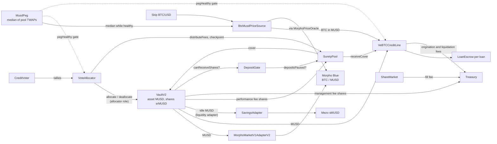
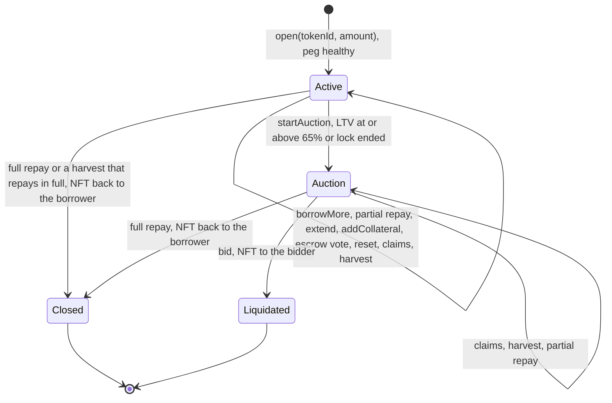

# Architecture

Surety is one MUSD lending vault whose allocation is decided by veBTC votes, a pool that holds the voters' rewards as first loss, and two credit lines the vault lends through. v2 adds a MUSD/USD price built from Mezo's own pools, a savings adapter that keeps the vault's idle MUSD in sMUSD, protocol fees paid to a treasury, loans that the escrowed NFT's rewards can repay, a market for vault shares, and testnet starter kits. This document covers each contract, the MUSD peg, the fees, the epoch timeline, the loss waterfall and how a cover is sized, the deposit gate, the veBTC loan lifecycle, the oracles, and the vault configuration as deployed. Addresses are in the [README](../README.md#deployments) and in `contracts/deployments/<chainId>.json` (v1 in `contracts/deployments/v1/`).



## Contracts

### Surety vault: Morpho VaultV2

**Purpose.** Holds lenders' MUSD and issues srMUSD shares. It is Morpho's VaultV2, vendored unmodified (`contracts/lib/vault-v2` at `97bcce9`, the same sources as Mezo's own VaultV2 on mainnet). Surety adds no code to it; every Surety contract acts through a role or hook VaultV2 already has.

**How Surety plugs in.**

- The `VoteAllocator` is the only allocator. It moves MUSD between the vault and its adapters with `allocate` and `deallocate`, sets `maxRate`, and sets the liquidity adapter.
- The `SuretyPool` is the performance-fee recipient. The fee is 10% of the vault's interest, minted as srMUSD.
- The treasury is the management-fee recipient: 0.20% of total assets a year, minted as srMUSD (v2).
- The `DepositGate` is the receive-shares gate. The send-shares, receive-assets and send-assets gates are unset, so exits are never gated.
- Adapters: `MorphoMarketV1AdapterV2` (Morpho's own adapter, for Morpho lines), `VeBTCCreditLine`, and `SavingsAdapter` (v2).
- The `SavingsAdapter` is the liquidity adapter while parking is on: deposits land in sMUSD and withdrawals pull from it. The allocator keeps 10% of total assets as a buffer outside the lines, parked in sMUSD with the rest of the vault's cash. An exit larger than the vault's cash can use VaultV2's permissionless `forceDeallocate`, which moves assets from an adapter to idle for a 1% penalty paid to the remaining holders, or sell srMUSD on the `ShareMarket`.

**Trust.** VaultV2's accounting: losses are realised at once, gains (interest, donations, covers) are recognised no faster than `maxRate`, and caps, timelocks and gates are enforced as Morpho documents them.

### CreditVoter

**Purpose.** The lending gauges. Each epoch, veBTC NFTs split their voting power across credit lines, and the tallies decide each line's share of the vault.

**Key functions.**

- `vote(tokenId, lineIds, weightsBps)`: by the NFT's owner or an approved address. Up to 10 distinct active lines, each weight non-zero, summing to 10,000 bps. The NFT's power is `veBTC.votingPowerOfNFTAt(tokenId, epochStart)`, its boosted power at the start of the epoch; zero power reverts. A second ballot from the same NFT in the same epoch replaces the first.
- `poke(tokenId)`: permissionless. Recasts the NFT's stored ballot into the current epoch at the new snapshot. Lines deactivated since are dropped and the remaining weights rescaled to 10,000. Reverts when the ballot is already current, when none of its lines is active, and for a burned NFT.
- `addLine` (bootstrap only), `endBootstrap`, `proposeLine` and `executeLine` (after `LINE_TIMELOCK`), `setLineActive`, `setEscrowRegistry` (once).
- Views: `currentEpoch`, `line`, `lineCount`, `lineVotes(epoch, lineId)`, `totalVotes(epoch)`, `tokenVotes(epoch, tokenId, lineId)`, `ballotOf`.

**Invariants.**

- Per epoch, the line tallies sum to the epoch total, and each line's tally is the sum of its ballots; the rounding remainder of a split goes to the ballot's last line, so an NFT's tallies sum to exactly its power.
- Only the current epoch is ever written, so a closed epoch's tally is final.
- One snapshot per NFT per epoch: power is read at the epoch start, so a lock created, merged into or transferred during the epoch adds nothing until the next one. Ballots are refused during an epoch's first second, when a veBTC checkpoint written in the same block could still move the snapshot.
- NFTs held by a Surety loan escrow cannot vote or be poked, so a borrower cannot vote credit toward their own line with collateral.
- Lines are never removed, only deactivated. A Morpho line must use the vault's Morpho adapter with canonical market parameters that lend MUSD under the adapter's IRM; a veBTC line must report `vault()` equal to the Surety vault. Each market and each veBTC adapter can be listed once, and every adapter must already be a vault adapter.

**Trust.** veBTC's `votingPowerOfNFTAt`, `ownerOf` and `isApprovedOrOwner`. The owner lists lines: instantly only during the bootstrap, which the deploy script ends right after listing lines 0 and 1, then through `proposeLine` and `executeLine` after `LINE_TIMELOCK` (0 on testnet, 1 day on mainnet; the constructor refuses 0 on Mezo mainnet). `setLineActive` takes effect at once: an inactive line takes no new ballots or pokes, and its target drops to zero at the next rebalance.

### VoteAllocator

**Purpose.** Holds the vault's allocator role, turns tallies into allocations, parks the vault's cash in sMUSD between rebalances, and measures each line's interest so the pool can split voter fees by line.

**Key functions.**

- `rebalance()`: permissionless and safe to repeat. In order:
  1. Accrue the vault. Have the pool checkpoint every line's losses; a failing checkpoint is reported (`CheckpointFailed`) and skipped.
  2. Measure each line's interest since the last snapshot and add it to the line's pending interest. Measure the savings yield the same way, from the SavingsAdapter's cumulative counter.
  3. On the first rebalance of an epoch, fix the tally epoch: the previous epoch if any active line got votes in it, otherwise the current one (bootstrap, which follows the live tally until an epoch closes with votes). Oracle liveness plays no part in this choice.
  4. Set targets. `deployable = totalAssets × (1 − 10%)` is split over active lines by votes. Each share is capped by the room the VaultV2 absolute and relative caps of its ids leave once the other lines have given back what they hold above their own shares. An active line that cannot take new money (stale oracle, paused veBTC line, or a line whose calls revert) is held at `min(current, target)`. Inactive and unvoted lines target zero.
  5. Deallocate overweight lines, bounded by what they can pay now (Morpho market liquidity, the veBTC line's cash).
  6. If the MUSD peg is healthy (or no peg is set), allocate to underweight lines in line order, from idle MUSD first and then from savings, withdrawn just before the allocation that needs it, re-reading the caps before each move. If the peg is unhealthy or cannot be read, fund no line and emit `PegUnhealthy`. A move the vault rejects is reported (`MoveFailed`) and skipped. Gaps under one billionth of a target are left alone.
  7. Settle savings: with parking on, park all idle MUSD (what deallocations, forced exits and covers left there) in savings, unless savings failed to pay in this run; with parking off, bring everything in savings back to idle.
  8. Checkpoint every line again, so the pool's Morpho mark reflects the shares this run left in the market.
  9. Snapshot each line: for Morpho lines, the adapter's supply shares and the market's supply share price; for the veBTC line, its `interestEarnedTotal()`.
  10. On the first rebalance of an epoch, hand the pending interest of every line to `SuretyPool.distributeFees(cohortEpoch, lineIds, interest)`, where `cohortEpoch` is the tally epoch that drove the allocation until now. The savings yield goes in the same call under `SAVINGS_LINE_ID`, so its fee part reaches the reserve and no line's cohort. The very first rebalance after deployment only sets the baseline.
- `setSuretyPool` and `setSavings` (once each; `setSavings` also turns parking on), `setParking(bool)`, `setPeg(peg)` (replaceable; zero removes the gate), `setMaxRate` (at most VaultV2's `MAX_MAX_RATE`, 200% a year).
- Views: `targets()`, `lineAssets(lineId)`, `ledger(lineId)`, `savingsLedger()`, `pegGateOpen()`, `activeTallyEpoch`, `lastRebalanceEpoch`.

**How interest is measured.** Never from changes in a line's assets, because anyone can move those with `forceDeallocate`, and covers and losses move them too. A Morpho line earns `sharesAtSnapshot × (sharePriceNow − sharePriceAtSnapshot)`, computed with Morpho's share math on the accrued market. Only interest raises Morpho's supply share price and only bad debt lowers it, so nobody else's deposits or withdrawals change the result, and a drop measures zero (the pool treats it as a loss). The veBTC line and the savings adapter each report a cumulative counter that capital moves do not touch, and the allocator measures its increase.

**Invariants.** Holds no MUSD and no srMUSD. The only capital moves are VaultV2 `allocate` and `deallocate` with the adapter and data the CreditVoter lists for a line, or with the savings adapter set once; VaultV2 rejects anything that is not its adapter and enforces the caps. Savings is not a line: no votes, no target, no cap room.

**Trust.** The CreditVoter's line list and tallies, the peg's `pegHealthy`, and sMUSD paying out what the savings adapter holds. A veBTC line's own calls (`ids`, `paused`, `oracle`, `cash`, `interestEarnedTotal`) are guarded, so a line whose calls revert only makes itself ineligible; if savings cannot pay, the move is reported, lines are funded from idle MUSD above the buffer only, and the run parks nothing. The owner's `setMaxRate`, `setParking` and `setPeg` take effect at once; `maxRate` should stay at the maximum, since a lower rate slows the recognition of covers.

### SuretyPool

**Purpose.** Holds the voters' rewards as first loss. Rewards for backing a line sit in cohorts keyed by (line, tally epoch), as srMUSD that keeps compounding inside the vault. A cohort is slashed first when its line records a loss; after it matures it is claimed by the NFTs that voted.

**Key functions.**

- `postIncentive(lineId, assets)`: a sponsor's MUSD is deposited into the vault and joins cohort (line, current epoch).
- `refundIncentive(lineId, epoch)`: after the epoch ends, a sponsor of a line that drew no votes in it gets back its pro-rata part of what is left of the cohort.
- `distributeFees(cohortEpoch, lineIds, interest)`, allocator only. Takes the srMUSD the pool received since the last call (the performance fee, plus anything sent to it directly). First it credits the fee shares that VaultV2 minted on re-recognised cover MUSD back to the cohorts those covers slashed (see below). The rest is split across lines pro rata to their interest and goes to cohort (line, `cohortEpoch`) when the line had votes in that epoch; everything else, the savings yield's part included, goes to the reserve.
- `claim(tokenId, lineId, epoch)`: permissionless, after maturity. Pays `finalShares × tokenVotes / lineVotes`, where `finalShares` is frozen at the cohort's first claim. The shares go to the NFT's owner, to the borrower when the owner is a Surety loan escrow, or to the reserve when the NFT was burned (merged or withdrawn).
- `checkpoint(lineId)`: permissionless; records any new loss (below).
- `cover(lineId)`: permissionless and repeatable; checkpoints, then covers as much of the line's uncovered loss as the pool and the vault's available MUSD allow (below).
- `setAllocator`, once. The owner has no other power.
- Views: `cohort`, `maturityOf(epoch)`, `claimable`, `uncoveredLoss`, `coverCapacity`, `depositsPaused`, `lossRecorded`, `lossCovered`, `reserveShares`, `highWaterMark`.

**Invariants.**

- `lossCovered ≤ lossRecorded` for every line.
- The shares in cohorts plus the reserve equal the pool's accounted shares, and every share that entered a cohort is claimed, slashed, refunded or still held.
- Shares leave the pool only to a claimant, a refunded sponsor, or (redeemed as MUSD) to the vault or line being covered.
- At most `SEASON + 2` cohorts per line are unmatured. Matured cohorts take no inflows, so their share count at maturity is final.
- The reserve is never claimable.

**Trust.** VaultV2 (share prices, `previewWithdraw`, `withdraw`), the CreditVoter's tallies, Morpho Blue's market accounting, and the veBTC line's `badDebtTotal`. A line's recorded loss is bounded by what the vault allocated to it, which caps what a misbehaving line could make the pool pay.

### DepositGate

**Purpose.** The vault's receive-shares gate. It holds new srMUSD back while `SuretyPool.depositsPaused()` is true, so nobody can buy in at the depressed price after a loss and capture the voter-funded cover meant for the lenders who took it. Rules are in [Deposit gate](#deposit-gate).

**Key function.** `canReceiveShares(account)`: always true for the pool and the treasury; otherwise `!pool.depositsPaused()`, and false if that view reverts. It never reverts, as VaultV2 requires of gates.

**Trust.** Every fee recipient must be answered without reading the vault. VaultV2 asks the gate about each fee recipient during every accrual, and while a cover is being re-recognised `depositsPaused` reads the vault's accrued total assets, which would accrue and ask the gate again. So the pool must stay the performance-fee recipient and `treasury` the management-fee recipient, both fixed in the gate. Letting the treasury through while deposits are paused is safe only while it stays a pure fee sink: it receives fee shares minted for elapsed time, never for MUSD paid in, and must not deposit, buy or take share transfers while a loss is being covered.

### VeBTCCreditLine

**Purpose.** Lends MUSD against locked veBTC NFTs without unlocking them. It is both a VaultV2 adapter (the vault allocates MUSD into it and deallocates idle cash out) and a small isolated lending market. Each loan's NFT sits in its own `LoanEscrow` clone.

**Key functions.**

- Adapter: `allocate` and `deallocate` (vault only; lent-out MUSD cannot be deallocated), `ids()` (the adapter id and the veBTC collateral id), `realAssets() = cash + totalDebt` with interest up to the current second, `receiveCover(assets)` (pool only).
- Borrowing: `open(tokenId, amount)`, `borrowMore`, `repay` (anyone, partial or full), `extend`, `addCollateral`. `open` and `borrowMore` revert `PegUnhealthy` while the MUSD peg is unhealthy and pay the origination fee to the treasury.
- Escrow actions, borrower only: `escrowVote`, `escrowReset`, `escrowClaim`, `escrowClaimRebase`.
- Auto-repay (v2): `setAutoRepay(loanId, bool)` by the borrower; `harvest(loanId, rewards, tokens)` by anyone while auto-repay is on, by the borrower otherwise (below).
- Liquidation: `startAuction`, `auctionPrice`, `bid`.
- Owner: `pause(bool)` for new borrowing, `setPegCheck(bool)`, `setSuretyPool` once.
- Views: `loan`, `debtOf`, `totalDebt`, `healthOf`, `maxBorrow`, `utilizationWad`, `interestEarnedTotal`, `badDebtTotal`, `isEscrow`, `borrowerOfEscrow`, `params`, `treasury`, `peg`.

**Parameters as deployed (v2).** Max LTV 50% for timed locks and 40% for permanent locks; liquidation at 65% LTV; 3% liquidation fee; auction floor 85% of collateral value; auction decay 10 minutes on testnet, 6 hours on mainnet; minimum remaining lock time to borrow 1 hour on testnet, 3 days on mainnet; origination fee 0.25%; 20% of the liquidation fee leaves the line, half of that to whoever started the auction. Collateral value is `locked.amount` times BtcMusdPriceSource's BTC price in MUSD; lock boosts are ignored. The constructor refuses any parameters where the floor does not sit above debt plus fee at the trigger, `floorBps × 10,000 > liqLtvBps × (10,000 + liqFeeBps)`: with v2's values, 85% against at most 66.95%. v1 ran with liquidation at 70% LTV and a 70% floor.

**Harvest.** The escrow claims the NFT's fees and bribes from the reward contracts the caller lists, to the line. The line counts only what the claim moved: the MUSD received repays the loan (the excess goes to the borrower, and repaying the whole debt closes the loan and returns the NFT, as `repay` does), and every other listed token received goes to the borrower; MUSD and the veBTC address are never forwarded as tokens. Then the veBTC rebase is claimed as in `escrowClaimRebase`: compounded into the lock while it is live. A refused rebase claim does not stop the harvest. Harvests work on Active and Auction loans and never read the oracle or the peg. The keeper harvests auto-repay loans once per Mezo epoch.

**Invariants.**

- `realAssets == cash + totalDebt`, the line's MUSD balance covers `cash`, and per-loan debts sum to `totalDebt` within one wei per open loan.
- `badDebtTotal` never decreases; covers add cash instead.
- Every open loan's escrow holds its NFT; a settled loan's escrow holds nothing.
- Rounding favours lenders: borrowing mints normalised debt rounded up, partial repayment burns it rounded down, and debts round up.
- `interestEarnedTotal` (interest through the borrow index plus the lenders' part of liquidation fees) only grows, and capital entering or leaving the line does not move it.
- Fees never pass through `cash`: the origination fee comes out of the borrower's proceeds, and the three parts of a liquidation fee add up to the fee exactly.
- No `open` or `borrowMore` succeeds while the peg check is on and the peg is unhealthy.

**Trust.** The price source, the peg, veBTC's lock data, and the vault. The owner can pause new borrowing and switch the peg check off; it cannot move NFTs or MUSD. The treasury is fixed at deployment.

**Utilisation and forced exits.** Utilisation is `debt / (cash + debt)` on the line's own cash. Anyone can pull that cash out with `forceDeallocate` (paying the 1% penalty to lenders). Utilisation then reads 100%: every borrower accrues at the curve's maximum APR and new loans revert until the allocator refills the line. The keeper rebalances at every epoch flip and can rebalance mid-epoch when the line's cash falls well below its target.

### LoanEscrow

**Purpose.** Custodies the veBTC NFT of exactly one loan. Deployed as an OpenZeppelin `Clones` proxy per loan, so no NFT ever shares custody with another.

**Key functions.** `initialize` (once, by the line, in the transaction that creates the clone; the implementation is locked at construction), `release(to)`, `vote`, `reset`, `claimRewards`, `claimRebase`, `extend`, `increaseAmount`. All but `initialize` are callable by the line only, and the line calls them only for the loan's borrower, a harvest, or its own settlement.

**Invariants.** Every target (veBTC, PoolsVoter, RewardsDistributor, BTC) is fixed at initialisation. There is no generic call or execute, no meta-transaction support, no `onERC721Received` and no payable entry point. The NFT arrives by plain `transferFrom` and leaves only through `release`. `claimRewards` forwards only the balance increase of each listed token, measured on live balances, and never treats the veBTC contract as a token.

**Trust.** Mezo's veBTC, PoolsVoter and RewardsDistributor behave as their verified sources do.

### LinearKinkIrm

Borrow APR of the veBTC line as a function of utilisation: 2% at 0%, rising linearly to 8% at 80% utilisation, then to 60% at 100%. Applied per second as simple interest between accruals. APRs above 1000% are refused at construction.

### SavingsAdapter

**Purpose.** A VaultV2 adapter that parks the vault's idle MUSD in Mezo's MUSD Savings Rate vault (sMUSD). The allocator makes it the vault's liquidity adapter. It is never a credit line and never voted on.

**How it works.** sMUSD is not ERC-4626: `deposit` and `withdraw` move MUSD 1:1, and yield is paid separately in MUSD through a global index; `withdraw` also pays all claimable yield. The adapter's position is the MUSD it holds plus its sMUSD plus the yield claimable now. `allocate` deposits everything it holds; `deallocate` pays from MUSD held first, then claimed yield, then principal, withdrawing exactly what is missing. `harvest()` is permissionless: it claims the yield and deposits it again. `interestEarnedTotal` counts the yield paid plus what is claimable, independently of capital moved in or out.

**Invariants.** `realAssets` never reverts, as VaultV2 requires: if sMUSD's views revert, it reports the MUSD held plus the sMUSD balance at the last deposit or withdrawal, without yield. A deposit or withdrawal that does not move sMUSD 1:1 reverts, and so does a deallocation sMUSD cannot pay, so VaultV2 never books a move that did not happen.

**Trust.** sMUSD is an upgradeable proxy administered by Mezo; its owner can upgrade it or switch its strategy, and either can make withdrawals revert. The VoteAllocator's owner can then stop parking. Its yield has been about 0.05% a year lately ([docs/BUSINESS.md](BUSINESS.md)).

### ShareMarket

**Purpose.** A secondary market for srMUSD. A lender lists shares at a discount to the vault's live share price; buyers fill the listing, in part or in full, for MUSD. It lets a lender leave while the vault's cash is lent out and `redeem` would fail.

**Key functions.** `list(shares, discountBps)` (the shares move into the market), `fill(id, shares, maxAssets)`, `cancel(id)`, `cancelAndRedeem(id, minAssets)`; views `listing`, `openListingCount`, `openListings(start, count)`, `listingsOf`, `bestListing`, `quote`, `isOpen`.

**Rules.** A fill of `shares` costs `convertToAssets(shares) × (1 − discount)`, read when the fill happens and rounded up. The treasury's 10 bps fee comes out of the seller's side: the buyer pays exactly the price. While the deposit gate refuses share receivers, `list`, `fill` and `cancel` revert `ShareReceiptPaused`; `cancelAndRedeem` stays open and redeems the listed shares for the seller. Listings, fills and remainders are at least 1e-6 srMUSD; a fill that would leave less returns the rest to the seller and closes the listing.

**Trust.** No owner. MUSD goes from the buyer to the seller and the treasury directly; the market holds only the shares of open listings, and only their seller can take them back.

### Sponsor and the starter-kit relayer (testnet)

**Purpose.** Lets a brand-new wallet try Surety on testnet with no setup. `starterKit(user)`, called by a relayer the owner names, sends the wallet 0.00005 BTC for gas (as native BTC), creates a 0.001 BTC veBTC lock for it (28 days, long enough to borrow) and sends 50 test MUSD. One kit per wallet ever, at most `dailyLimit` (100) a UTC day. The `StarterKit` events are the public ledger of who has tried it.

**Relayer.** `POST /api/starter` in the web app (`apps/web/api/starter.ts`), a serverless function holding the testnet relayer key. It checks the address, the Sponsor's limits and its own per-IP limit (three requests per ten minutes) before it simulates and sends.

**Trust.** Testnet only: the constructor reverts on Mezo mainnet, and the deploy script never deploys it there. The owner can change the kit, relayers and limit, and withdraw everything; nothing in it belongs to users. A kit sent to the Sponsor itself is refused.

### Price sources

- `SkipPriceSource`: BTC/USD from Mezo's Skip precompile (`0x7b7c…0015`, Chainlink interface), normalised to 18 decimals. Every read checks that the feed still reports 18 decimals and reverts on a non-positive answer, a future-dated round, or a round older than 60 seconds.
- `StressedPriceSource` (testnet stress deployment only): wraps a price source and lets anyone apply a haircut of up to 90% for up to 2 hours; a new shock replaces the current one, and the haircut disappears when it expires. The deploy script refuses it on mainnet.
- `BtcMusdPriceSource` (v2): BTC priced in MUSD, the price both lines use. See [the MUSD peg](#the-musd-peg).
- `MorphoPriceOracle`: the Morpho Blue oracle for the BTC / MUSD market: its source's BTC price in MUSD at Morpho's 1e36 scale. In v2 the source is BtcMusdPriceSource; in v1 it was the Skip source, with MUSD at $1. Reverts from its source propagate.

### Libraries

- `EpochLib`: an epoch's id is its start timestamp, `t − (t mod length)`. Unix time 0 was a Thursday 00:00 UTC, so weekly epochs flip on Thursdays like Mezo's.
- `LineIds`: VaultV2 cap ids, encoded exactly as `MorphoMarketV1AdapterV2` encodes them: per adapter (`"this"`), per collateral token (`"collateralToken"`) and per Morpho market (`"this/marketParams"`).
- `TickPrice` (v2): tick-to-price math for the CL sources, written for Surety (MIT), and the mean tick of a window, floored toward −∞.

## The MUSD peg

Mezo's Skip precompile serves BTC/USD only. v2 reads MUSD/USD from Mezo's own pools, and uses it in two ways: to price BTC collateral in MUSD, and as a circuit breaker on new credit.

### Sources

Each source implements `read() returns (bool ok, uint256 musdUsdWad)`, never reverts, and reads not ok outside [$0.50, $2]. Their pools, windows and floors are fixed at deployment.

| Source | Reads | Not ok when |
| --- | --- | --- |
| `ClTwapPegSource` | The 30-minute TWAP of a Tigris concentrated-liquidity pool pairing MUSD with a dollar stablecoin (taken as exactly $1). Mainnet: CL mUSDC/MUSD `0xCC37…aC1a` | The window's harmonic-mean in-range liquidity is under `minLiquidity` (1e19 on mainnet), there is not enough history, or a call fails |
| `StableTwapPegSource` | A Tigris basic stable pool's `quote` of one MUSD, averaged over its last `granularity` (2) observation periods. Mainnet: basic mUSDC/MUSD `0xEd81…c356` and MUSD/mUSDT `0x1090…031A` | The pool's latest observation is older than `maxAge` (6 hours on mainnet), it holds fewer periods than `granularity`, or a call fails |
| `BtcCrossPegSource` | Skip BTC/USD divided by the 30-minute TWAP price of BTC in a Tigris CL BTC/MUSD pool. Mainnet: `0x9CBc…5022` | Its liquidity floor (2e20 on mainnet) is not met, or Skip reverts (stale or bad round) |
| `StressedPegSource` (testnet only) | $1, or an override anyone can set for up to 2 hours | The override is an outage (zero) |

**The window-liquidity floor.** A mean tick says nothing about what it cost to move it: a thin pool can be pushed past every position into an empty range, held there for free and swapped back before the read. So a CL source also needs the harmonic-mean liquidity in range over the window, `window × 2^128 / (growth of secondsPerLiquidityCumulativeX128)`, to reach `minLiquidity`. Every second with nothing in range adds 2^128 to that accumulator, and the constructor requires `minLiquidity > window`, so a single second out of range fails the whole window. A pushed pool therefore drops out instead of moving the price.

**Freshness of the basic pools.** A basic pool writes an observation only on the first swap, mint, burn or `sync` at least 30 minutes after the previous one, and `quote` reads closed periods only. Past `maxAge` the source reads not ok. `sync()` is permissionless and writes an observation with unchanged reserves, so the keeper syncs both mainnet pools at most hourly to keep them reading.

### MusdPeg

`MusdPeg(sources, minSources, maxSpreadBps, bandBps)` has no owner.

- `musdUsdWad()`: the median of the sources that read ok (the mean of the middle two for an even count); reverts `PegUnavailable` with fewer than `minSources`.
- `pegHealthy()`: at least `minSources` read, the spread between the highest and lowest reading is at most `maxSpreadBps` of the median, and the median is within `bandBps` of $1. Never reverts.
- `readings()`: every source's answer, for the app.

| Deployment | Sources | `minSources` | `maxSpreadBps` | `bandBps` |
| --- | --- | --- | --- | --- |
| Mainnet (v2, planned) | CL mUSDC/MUSD, basic mUSDC/MUSD, basic MUSD/mUSDT, BTC cross | 2 | 1000 | 300 |
| Testnet (v2) | StressedPegSource (testnet has no usable MUSD pool) | 1 | 1000 | 300 |

The mainnet values come from 672 half-hour samples of the live pools between 2026-10-26 and 2026-11-09; the reasoning is in [`MusdPeg.sol`](../contracts/src/oracles/peg/MusdPeg.sol). On a fork of mainnet at block 13,100,532 the sources read 0.99144 (CL mUSDC/MUSD), 0.99125 (basic mUSDC/MUSD) and 1.00246 (BTC cross), with basic MUSD/mUSDT past its freshness bound; the median is 0.99144 and the peg healthy (`LivePeg` fork suite).

### BtcMusdPriceSource and the clamp

`priceWad = btcUsd × 1e18 / divisor`. While `pegHealthy()`, the divisor is the median clamped to [$1, $1 + `maxPremiumBps`]; otherwise, and on any failed or malformed answer, it is exactly $1. `maxPremiumBps` is 300 on both chains and at most 500 by construction.

- BTC is never valued above BTC/USD, so the peg cannot help anyone borrow more. A MUSD below $1 changes nothing.
- A MUSD premium lowers collateral value by at most 2.91% (`1 − 1/1.03`), and only while the sources agree and sit near $1. That bound stays inside both lines' cushions: on the veBTC line it can pull only loans already at 63.1% LTV or more over the 65% trigger; on Morpho only positions at 83.5% or more over the 86% LLTV.
- It reverts only when the BTC/USD source does, so liquidations keep working through a depeg or a broken peg. A gas-starved peg call reads as $1, the higher price, so starving it cannot make a loan liquidatable.

### The breaker and the allocation gate

- `VeBTCCreditLine.open` and `borrowMore` revert `PegUnhealthy` while the peg is unhealthy. Repayment, harvests, `extend`, `addCollateral`, escrow actions, auctions and bids never read the peg. The owner can switch the check off with `setPegCheck(false)` if Mezo's pools thin out below `minSources` for good.
- `VoteAllocator.rebalance` funds no line while the peg is unhealthy (or cannot be read) and emits `PegUnhealthy`; overweight lines are still deallocated and idle MUSD is still parked. The owner can replace the peg or remove the gate with `setPeg`.
- Withdrawals, covers, claims and the deposit gate do not read the peg.

## Fees

| Fee | Rate (v2) | Paid by | Goes to | Taken in |
| --- | --- | --- | --- | --- |
| Performance fee | 10% of the vault's interest | Lenders | SuretyPool: voters' cohorts by line, the reserve for unattributed shares and savings yield | VaultV2, minted as srMUSD |
| Management fee | 0.20% of total assets a year (63,419,583 per second, WAD) | Lenders | Treasury | VaultV2, minted as srMUSD for elapsed time; the deposit gate always lets the treasury through |
| Origination fee | 0.25% of each amount borrowed on the veBTC line | Borrowers | Treasury | `open`, `borrowMore`: the borrower receives the amount minus the fee and owes the full amount (`OriginationFeePaid`) |
| Liquidation fee | Up to 3% of the debt, out of a winning bid's proceeds | The defaulted borrower | 80% lenders (as line interest), 10% treasury, 10% whoever called `startAuction` | `bid` (`LiquidationFeePaid`); a bid below debt plus fee pays the fee only from what is above the debt |
| ShareMarket fee | 0.10% of each fill | The seller | Treasury | `fill` |
| Forced-exit penalty | 1% of a `forceDeallocate` | The exiting holder | The remaining holders | VaultV2 |

What these add up to and what they pay for is in [docs/BUSINESS.md](BUSINESS.md). The treasury is the deployer key today.

## Epoch timeline

Epochs are 1 hour on testnet and 1 week on mainnet. `SEASON` is 4 epochs. For a tally epoch `t` and a line `L`:

| Epoch | What happens |
| --- | --- |
| `t` | Ballots are cast at the power each NFT had at the start of `t`. Sponsor incentives posted during `t` join cohort `(L, t)`. The cohort is already slashable while `L` has votes in `t`. |
| `t+1` | The first rebalance of `t+1` fixes tally `t`, and the vault's allocation follows it for the whole epoch. Each rebalance measures the interest every line earned since the last one. |
| `t+2` | The first rebalance of `t+2` hands the interest earned while tally `t` drove the allocation to `distributeFees(t, …)`. The fee shares go to the cohorts `(L, t)` pro rata to each line's interest; the savings yield's part goes to the reserve. |
| `t+2` to `t+5` | Cohort `(L, t)` seasons and is slashed first when `L` records a loss. |
| `t+6` | `maturityOf(t) = t + (2 + SEASON) × epochLength`. From here the cohort takes no inflows, is never slashed, and can be claimed. |

So a cohort matures 6 hours after its epoch starts on testnet and 6 weeks after on mainnet. While tally `t` drives the allocation during `t+1`, voters are already casting tally `t+1`.

Mezo's own epochs also flip on Thursday 00:00 UTC. An escrowed NFT's fees and bribes for a Mezo epoch become claimable after it ends, which is when the keeper harvests auto-repay loans.

## Loss waterfall

### Recording a loss

`checkpoint(lineId)` records new loss; the allocator calls it for every line before and after each rebalance, and anyone else can call it at any time.

- **Morpho lines.** The pool accrues the market and compares its supply share price, `(totalSupplyAssets + 1) / (totalSupplyShares + 1e6)` with Morpho's virtual amounts, with the mark set at the line's last checkpoint. A drop is valued on `max(sharesAtMark, sharesNow)` of the adapter's supply shares: shares that left after the mark (through a `forceDeallocate`, possibly in the same transaction as the liquidation that made the bad debt) left at the impaired price, so their part of the loss is real for the vault and is recorded too. Drops worth at most `LOSS_DUST` (1e12 wei, 0.000001 MUSD) are ignored; Morpho's share price never falls through rounding, so any drop is bad debt. The mark then moves to the current price and shares, so a line that held no shares never carries a stale price into its next position. A loss before a line's first checkpoint is not measured; the deploy script checkpoints the Morpho line once.
- **veBTC line.** The increase of the line's cumulative `badDebtTotal` since the last checkpoint.
- **Bound.** A checkpoint never records more than the larger of the vault's allocation to the line's adapter now and at the line's previous checkpoint, so a forced exit between the loss and its checkpoint cannot shrink the bound either.

### Who pays

When `cover(lineId)` runs, the uncovered loss is paid in this order:

1. **The line's unmatured, backed cohorts**: every cohort `(L, e)` for the current epoch and the `SEASON + 1` epochs before it that holds shares and whose line had votes in `e`. They pay pro rata to their holdings.
2. **The reserve**: fee shares that could not be attributed to a voted line, the fee on savings yield, rounding, claims of burned NFTs, and the reserve's share of returned cover fees.
3. **Lenders**: whatever the pool cannot cover stays in the share price.

`cover` withdraws the MUSD from the vault by burning the pool's shares. For a Morpho line the MUSD goes back to the vault as idle assets (a Morpho supply made on the adapter's behalf would not be on the adapter's own share ledger and would be stranded), and the next rebalance parks it; for the veBTC line it is paid in through `receiveCover`. The MUSD moved is at most what the pool's slashable shares redeem for and at most what the vault can pay out now: its idle MUSD plus the savings adapter's position, which VaultV2 deallocates on a withdrawal larger than idle. A cover larger than that completes over several calls as MUSD comes back. `cover` is permissionless and safe to repeat.

### Sizing a cover

VaultV2 realises a loss at once but books the MUSD a cover returns as a gain: it recognises it no faster than `maxRate` and mints its performance fee `f` on it, to the pool. Returning the loss `U` itself would therefore over-slash the voters (their shares are burned at the depressed price) and leave lenders short by the fee. `cover` sizes the MUSD it moves so that, once VaultV2 has recognised it, every share is back at its pre-loss price and the pool is down exactly `U`.

Let `A` be the vault's total assets after accrual, `f` the performance fee (zero if the fee recipient cannot receive shares), `U` the uncovered loss, and `R` MUSD the vault holds but has not recognised yet (its real assets minus `A`, typically an earlier cover). `_sizeCover` computes:

```
X = A + (1 − f) × R          what non-fee holders own once R is recognised
G = U × X / (A + R)          the loss expressed against X              (rounded up)
D = X + G − f × A                                                       (f × A rounded up)
W = A × G / D                MUSD to move for a full cover              (rounded up)
```

With nothing pending (`R = 0`) this is `W = A × U / (A + U − f × A)`. Worked through: a loss leaves `A` assets for `T` shares, down from `(A + U) / T`. Withdrawing `W` burns `W × T / A` shares at the post-loss price. When VaultV2 recognises the returned `W` it mints fee shares worth `f × W` to the pool. With this `W`, the share price after recognition is exactly `(A + U) / T`, and the shares the pool burned minus the fee shares it got back are worth exactly `U` at that price.

The cover moves `min(W, maxAssets)`, where `maxAssets` is the smaller of what the slashable shares redeem for and the MUSD the vault can pay out now; a cover that would move all of `A` moves nothing. A partial cover of `w < W` closes `w × D / A` of `G` and covers `U − (G − w × D / A) × (A + R) / (X − f × w)` loss units (rounded down); with `R = 0` that is `w × (1 − f) × (A + U) / (A − f × w)`. Covering the rest later ends at the same price as one full cover. Rounding favours lenders: the MUSD of a full cover rounds up and the units of a partial one round down. `lossCovered` counts loss units, so it never exceeds `lossRecorded`.

**The fee shares go back to the slashed cohorts.** Each cover records which cohorts it cut and by how much, what the reserve paid, and how much of its MUSD is still unrecognised. As VaultV2 recognises the MUSD (measured as the vault's real assets no longer exceeding its total assets, oldest cover first), the next `distributeFees` calls credit the matching fee shares, `f × recognised × (totalSupply + virtualShares) / (totalAssets + 1)`, pro rata to what each cohort paid. The reserve keeps its own part, the part of cohorts that matured in the meantime, and rounding. At most 8 covers are credited per call. With this, the slashed cohorts themselves net exactly `U`.

**When the sizing is approximate.** It is exact when VaultV2 recognises the MUSD in one accrual, the share supply moves only through covers in between, and only this line's loss is outstanding. Otherwise, to second order: recognition over many accruals lets early fee shares share in later recognition, leaving lenders up to about `f × (1 − f) × W² / (2A)` short; losses on two lines covered one after the other overshoot by about `U₁ × U₂ / A`; and a deposit or withdrawal after the loss spreads the cover over the shares outstanding when it lands (deposits are held by the gate). The management fee is time-based and not part of the sizing: the treasury's fee shares dilute a cover recognised over a week by about 0.0038% (0.20% × 7 / 365). Savings yield that arrives while a cover is pending counts like a donation. `maxRate` must stay at VaultV2's maximum, 200% a year: below it recognition is slower, and a loss landing on interest the cap still holds back reads as a full loss. At 200% a year, MUSD worth 10% of total assets takes about 18 days to recognise.

## Deposit gate

`SuretyPool.depositsPaused()` is true when any of these holds:

1. **A loss is unrecorded.** For some line, a checkpoint now would record a loss above `LOSS_DUST`: for a Morpho line, `max(sharesAtMark, sharesNow) × drop` on Morpho's expected (accrued) balances; for the veBTC line, bad debt above what is recorded; both within the checkpoint's allocation bound. This pauses deposits from the moment the bad debt exists, before anyone checkpoints it.
2. **A loss is recorded but uncovered**, above `LOSS_DUST`, while the pool still holds shares that can cover it (the line's backed, unmatured cohorts or the reserve).
3. **A cover is still being recognised.** The cover MUSD VaultV2 has not recognised yet (the smaller of what the pool's covers returned and the vault's real assets minus its total assets) is above 5 bps of total assets.

While it is true, the gate refuses every new share receiver except the pool and the treasury: deposits and mints, srMUSD transfers, ShareMarket listings and fills, and the pool's own claim and refund payouts revert until deposits reopen. Nothing is lost meanwhile. Withdrawals, ShareMarket's `cancelAndRedeem` and in-kind exits through `forceDeallocate` are never gated.

Two rules keep the gate from pausing deposits indefinitely. An uncovered loss that nothing can cover pauses nothing, since lenders bear it either way. And only MUSD returned by covers counts as awaiting recognition, so a donation or a forced-exit penalty, which VaultV2 also recognises at no more than its max rate, cannot pause deposits on its own. The view never reverts on a line whose calls revert, and the gate fails closed if the view itself reverts.

How long a pause lasts depends on the loss: recording and covering take a keeper pass each, and recognition then runs at up to 200% a year of the vault's assets.

## veBTC loan lifecycle



1. **Open.** `open(tokenId, amount)`: the caller owns the NFT and has approved the line for it. The NFT must be a normal veBTC NFT (not managed or locked in a managed NFT), not a grant lock, with a positive locked amount, and a timed lock must have at least the minimum term left (permanent locks need none). `amount` must fit the line's cash and the max LTV, and the peg must be healthy. The line clones a `LoanEscrow`, moves the NFT into it with `transferFrom`, sends the MUSD less the 0.25% origination fee, and sends the fee to the treasury. The loan owes the full amount.
2. **While active.** The borrower votes the escrowed NFT on Mezo's PoolsVoter (`escrowVote`, `escrowReset`), claims fees and bribes (`escrowClaim`) and the rebase (`escrowClaimRebase`: compounded into the lock while it is live, paid to the borrower once it has expired), extends the lock (`extend`, which moves the maturity), adds BTC (`addCollateral`) and borrows more within the same limits. With auto-repay on, anyone may `harvest` instead: the NFT's MUSD rewards repay the loan and the rebase compounds into the lock. Anyone can repay; a full repayment closes the loan and returns the NFT. The NFT cannot vote on Surety's own CreditVoter while it is escrowed.
3. **Auction.** Anyone can call `startAuction(loanId)` once the loan's LTV reaches 65% or its timed lock reaches its end; the caller is recorded as the loan's keeper. The price starts at the live collateral value and decays linearly to the 85% floor over the auction duration, then stays there. During the auction the borrower can still claim rewards, harvest and repay (a full repayment still closes the loan), but cannot vote or reset the NFT on PoolsVoter: Mezo allows one vote or reset per NFT per Mezo epoch, and a late vote would hand the bidder an NFT it cannot reset until the next one.
4. **Bid.** `bid(loanId, maxPrice)` pays the current price. The line keeps up to the debt plus the 3% fee; of that fee 80% stays with lenders, 10% goes to the treasury and 10% to the keeper that started the auction. Any surplus goes to the borrower, and the NFT goes to the bidder. A price below the debt records the difference as bad debt, which the pool covers at the next `checkpoint` and `cover`. At the trigger the floor sits 18 points above debt plus fee, so a sale below the debt needs the collateral to keep falling during the auction.

## Oracles and fail-closed behaviour

All BTC prices come from Mezo's Skip BTC/USD precompile through `SkipPriceSource` (on testnet through `StressedPriceSource` on top of it), divided by MUSD/USD from the peg as described [above](#btcmusdpricesource-and-the-clamp).

| Component | When the Skip source reverts (stale for more than 60 seconds, non-positive, future-dated, or decimals changed) | When the peg is unhealthy or unavailable |
| --- | --- | --- |
| veBTC line | `open`, `borrowMore`, `startAuction` and `bid` revert, as do the `healthOf` and `maxBorrow` views. `repay`, `harvest`, `extend`, `addCollateral` and the escrow actions keep working; `repay` never reads the oracle | `open` and `borrowMore` revert `PegUnhealthy` (unless the owner has switched the check off). Collateral is priced with MUSD at $1; everything else works |
| Morpho market | `MorphoPriceOracle` reverts, so Morpho borrows, collateral withdrawals and liquidations revert. Supplying, repaying and adding collateral keep working | Priced with MUSD at $1 |
| VoteAllocator | The line is ineligible for new money and holds its current allocation up to its target. The choice of tally epoch does not depend on the oracle | Funds no line; deallocations and parking go on |
| SuretyPool, DepositGate, SavingsAdapter, ShareMarket | Do not read prices | Do not read the peg |

Failing closed on Skip blocks liquidations during an outage too; that trade-off is accepted so that no loan opens or settles on a bad price. The peg fails the other way: it never blocks a liquidation, and a peg that cannot be read prices MUSD at $1.

## Vault configuration as deployed

| Setting | v2 testnet (31611) | v2 mainnet (31612, planned from the dry run) |
| --- | --- | --- |
| Name and symbol | Surety MUSD, srMUSD | same |
| Owner, curator, sentinel | deployer key | deployer key at launch; to move to a multisig and timelock |
| Allocator | VoteAllocator only | same |
| Performance fee | 10%, to the SuretyPool | same |
| Management fee | 0.20% a year, to the treasury | same |
| Max rate | 200% a year (`MAX_MAX_RATE`) | same |
| Receive-shares gate | DepositGate (pool and treasury always let through) | same |
| Liquidity adapter | SavingsAdapter over sMUSD `0x6f46…8e16` | SavingsAdapter over sMUSD `0xb4D4…51CC` |
| Send-shares, receive-assets, send-assets gates; adapter registry | unset | unset |
| Adapters | MorphoMarketV1AdapterV2, VeBTCCreditLine, SavingsAdapter | same |
| Absolute caps: Morpho adapter id, BTC collateral id, market id | 10,000,000 MUSD each | 2,000 MUSD each |
| Absolute caps: veBTC line adapter id, veBTC collateral id | 10,000,000 MUSD each | 2,000 MUSD each |
| Absolute cap: savings adapter id | 1e27 (10⁹ MUSD) | same |
| Relative caps | 100% | 100% |
| Force-deallocate penalty | 1% on all three adapters | same |
| Vault curator timelocks | 0 | 1 day on all 17 timelockable functions, `increaseTimelock` last |
| Morpho adapter timelocks (`burnShares`, `setSkimRecipient`, `abdicate`, `increaseTimelock`) | 0 | 1 day, set before the vault adds the adapter |
| CreditVoter line timelock | 0 | 1 day |
| Epoch length | 1 hour | 1 week |
| Price source of the lines | BtcMusdPriceSource over StressedPriceSource (over SkipPriceSource) and MusdPeg | BtcMusdPriceSource over SkipPriceSource and MusdPeg |
| MusdPeg | StressedPegSource; 1 of 1, spread 1000 bps, band 300 bps; premium cap 300 bps | Four pool sources; 2 of 4, spread 1000 bps, band 300 bps; premium cap 300 bps |
| Morpho Blue and IRM | Mezo's testnet Morpho Blue `0xCe1d…5a73` and AdaptiveCurveIrm `0x0c97…7441`, LLTV 77% | Mezo's `0x5658…A311` and `0x3760…C1e7`, LLTV 86% |
| Treasury | deployer key | deployer key, until a multisig takes over |
| Sponsor | 5 kits funded (0.006 BTC, 300 MUSD), relayer `0x030E…7DdC` | none |

The 17 timelocked vault functions are `addAdapter`, `removeAdapter`, `increaseAbsoluteCap`, `increaseRelativeCap`, `setIsAllocator`, `setPerformanceFee`, `setPerformanceFeeRecipient`, `setManagementFee`, `setManagementFeeRecipient`, `setForceDeallocatePenalty`, `setAdapterRegistry`, `setReceiveSharesGate`, `setSendSharesGate`, `setReceiveAssetsGate`, `setSendAssetsGate`, `abdicate` and `increaseTimelock`. VaultV2's owner functions (owner, curator, sentinels, name, symbol) and the sentinel's risk-reducing actions (deallocate, decrease caps, revoke pending actions) have no timelock by VaultV2's design.

v1 (`contracts/deployments/v1/`) differs: no management fee and no liquidity adapter (idle MUSD stayed in the vault), lines priced by the Skip source with MUSD at $1, liquidation at 70% LTV with a 70% floor, no origination fee, and on testnet a Morpho Blue deployed from the pinned sources at LLTV 86%.

## Off-chain components

- **Keeper** (`keeper/`): one pass per interval, waking just after each epoch flip. It starts auctions on loans at the liquidation LTV or past their lock end, checkpoints and covers lines with losses, pokes stored ballots one second after the flip, rebalances once per epoch, harvests the savings adapter after the rebalance when it has yield, harvests every auto-repay loan once per Mezo epoch, syncs the peg's basic pools on mainnet (at most hourly per pool, adjustable with `--pool-sync-interval`), and optionally liquidates unhealthy Morpho positions. Every action is simulated before it is sent. It holds no role.
- **Starter-kit relayer** (`apps/web/api/starter.ts`): a serverless function that calls the testnet Sponsor's `starterKit` with the relayer key; see [Sponsor](#sponsor-and-the-starter-kit-relayer-testnet).
- **SDK** (`packages/sdk`): typed reads pinned to one block and batched through Multicall3, and unsigned transaction builders for every action, including the peg, fees, savings, ShareMarket, the Sponsor's ledger and a loan's harvest plan.
- **MCP server** (`packages/mcp`): read tools and unsigned calldata over stdio or streamable HTTP; no keys.
- **Web app** (`apps/web`): a static Next.js export plus the relayer function. The pages render a build-time snapshot of both chains, then swap in live reads, each time-boxed with fallback RPCs; `?demo=1` uses the SDK's example fixture.
